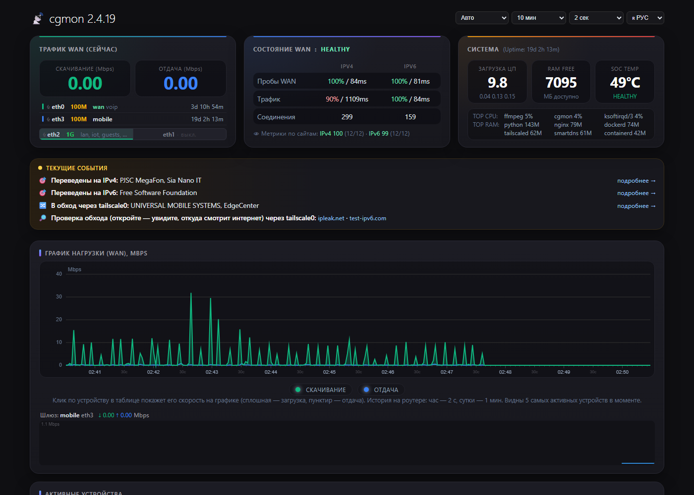
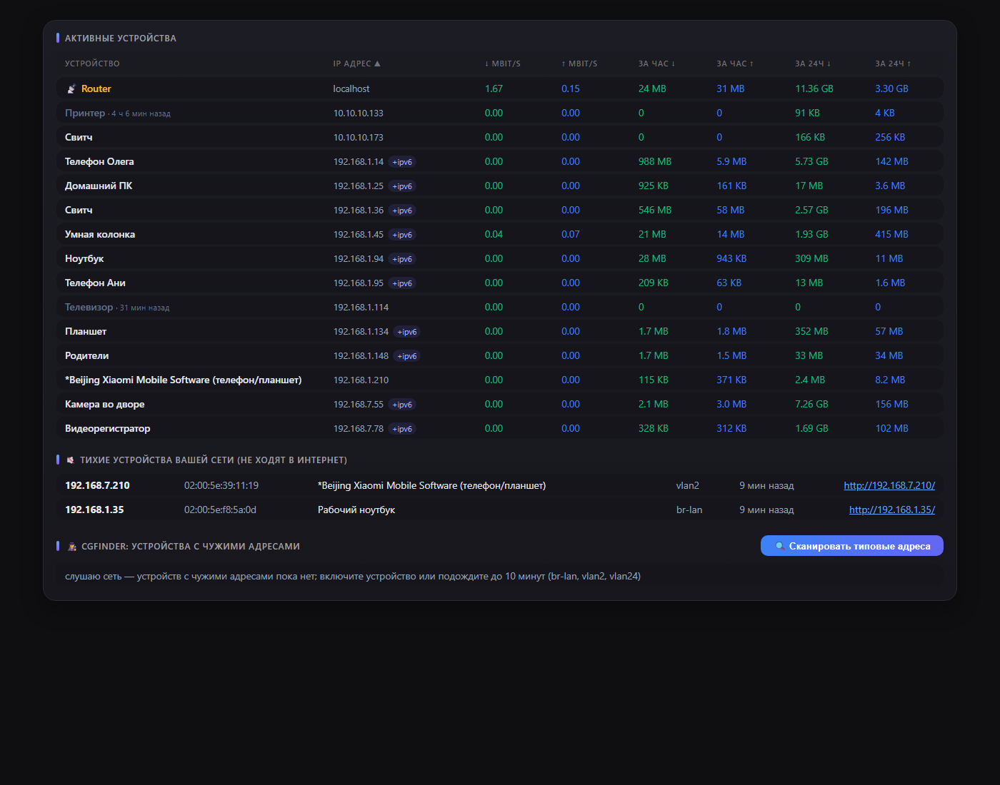
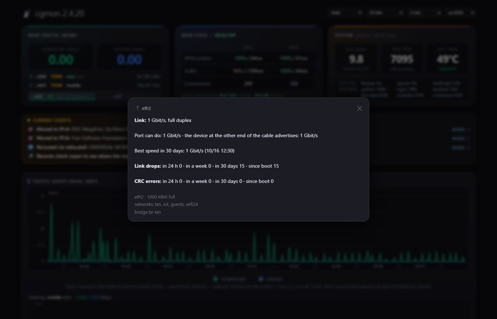
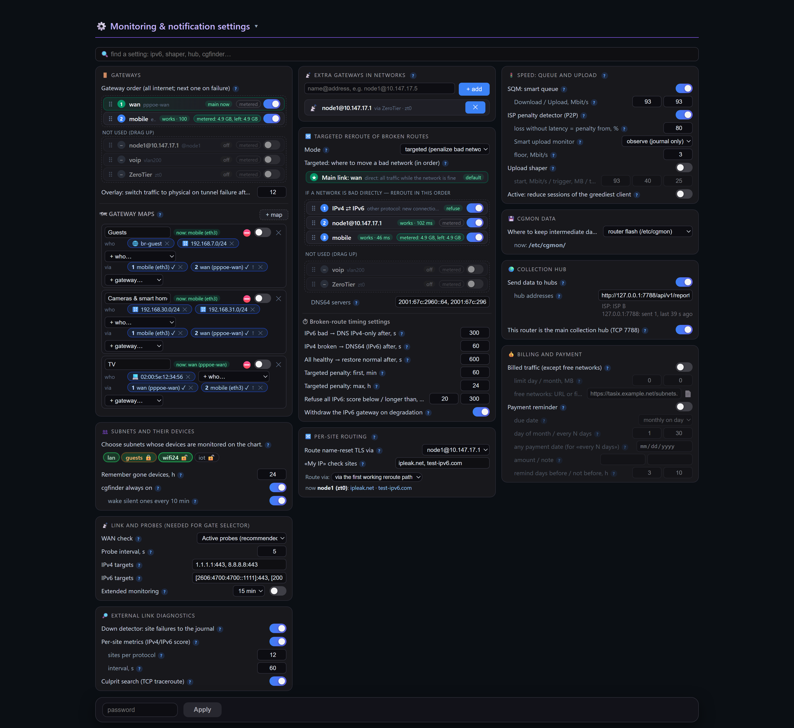
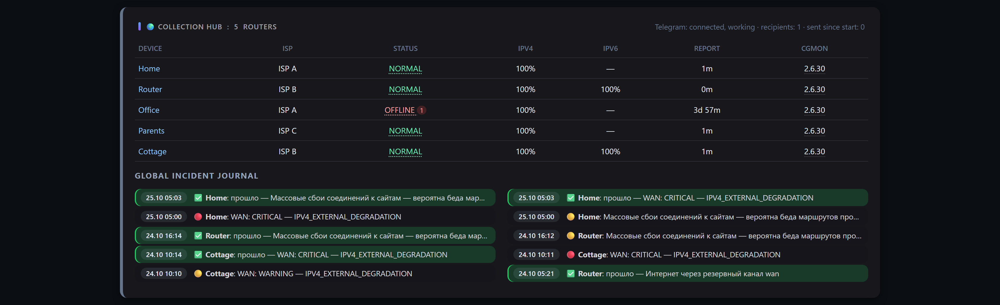
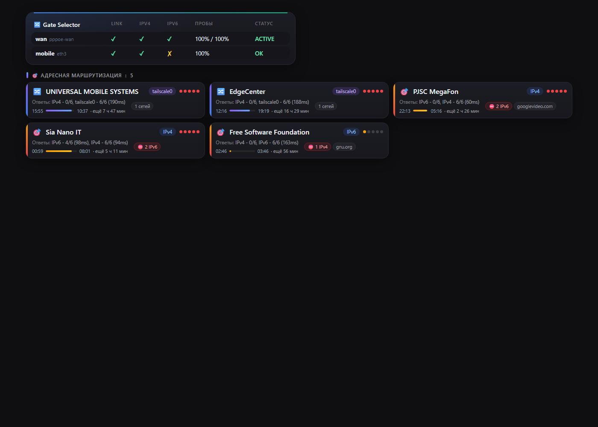
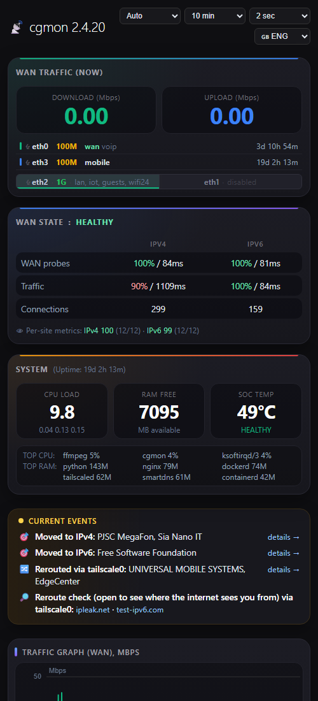

# cgmon

[English](README.md) · [Русский](README.ru.md) · [Oʻzbekcha](README.uz.md) · **Қазақша** · [中文](README.zh.md)

**OpenWrt / ImmortalWrt** роутерлеріне — соның ішінде провайдердің CGNAT-ы
артындағы роутерлерге — арналған интернет арнасының, conntrack/NAT, құрылғылар,
коммутатор порттары мен трафиктің мониторы, сондай-ақ көп роутерден ақауларды
жинайтын орталық. **~2 МБ** бір статикалық файл, **3–5 МБ RAM**, веб-бет және
Telegram хабарламалары. 64 МБ жады бар ескі MIPS роутерде де жұмыс істейді.
Қарапайым тілмен танысу — [docs/users.md](docs/users.md) (ағылшынша).



| | | |
|---|---|---|
| [](docs/screenshots/2-devices.png) Құрылғылар және cgfinder | [](docs/screenshots/3-ports.png) Порт мәліметтері: үзілулер, CRC, жылдамдық | [](docs/screenshots/settings.png) Баптаулар: бәрі карточкаларда |
| [](docs/screenshots/hub.png) Жинау орталығы | [](docs/screenshots/6-routing.png) Шлюздер және желілер бойынша маршруттау | [](docs/screenshots/8-phone.png) Телефонда |

> 2.x нұсқасы Rust-та жазылған және 1.x (Go) нұсқасын алмастырады. Конфигурация
> файлы, веб-бет, CGI, сокет және орталыққа есеп пішімі үйлесімді: 2.x орталығы
> 1.x роутерлерінен есептерді қабылдайды.

## Идея: дирижёр, роутер емес

cgmon Linux ядросы мен OpenWrt-те бұрыннан бар нәрселердің үстіне құрылады.
**Ол трафикті ешқашан бағыттамайды және ол арқылы бірде-бір пакет өтпейді**:
бәрін ядро жібереді, ал cgmon бақылайды және жағдай талап еткенде өз ережелерін
қосады, өзгертеді немесе алып тастайды:

- **nftables** — firewall-дың қасындағы өз кестелері (`inet cgmon` — лимитер,
  `inet cgmon_acct` — трафик есебі, `inet cgmon_route` — айналып өтуге арналған
  қосылу белгілері, `inet cgmon_gw` — шлюздер карталары, `inet cgmon_persite` —
  Per-Site Routing тізімі, `inet cgmon_v6` — хаттама бойынша бас тарту). Firewall
  ережелері ешқашан өңделмейді және firewall қайта жүктелмейді;
- **ядро маршруттауы** — қосылу белгілеріне байланған `ip rule` жазбалары, өз
  маршрут кестелері және негізгі шлюзді ауыстыруға `ip route replace`;
- **tc** — SQM кезектерінің ағашы және жіберу шейперінің жылдамдығы;
- **DNS** — DNS-сақтандырудың бүкіл хаттама режимінде (SmartDNS немесе dnsmasq)
  және Per-Site Routing тізімінің домендері үшін (dnsmasq nftset). Адрестік режим
  мен айналып өту DNS серверге тиіспейді.

Бақылау да ядро арқылы: conntrack және nftables есептегіштері netlink арқылы,
AF_PACKET сокетінен SYN/RST пакеттері мен DNS жауаптарының көшірмелері, порттар
үшін sysfs және ethtool ioctl, сондай-ақ өз сынақтары мен TCP трассировкалары.
Бір ағын, epoll, көмекші процестер жоқ. Демон тоқтаса немесе құласа, байланыс
бұзылмайды: ядро соңғы ережелермен жұмысын жалғастырады, ал келесі іске қосылу
өз кестелері мен күйін қайта алады.

## Мүмкіндіктер

**Арна және сайттар**
- **WAN күйі** — IPv4 және IPv6 арқылы TCP 443 сынақтары, NORMAL / WARNING /
  CRITICAL / RECOVERY фазалары және оқылатын оқиғалар журналы.
- **Down detector** — интернеттің өзі жұмыс істеп тұрғанда клиенттеріңізге қай
  сайттар жауап бермей қалғанын қызмет пен желі иесінің (Google, Telegram…)
  атауымен DNS және AS деректері бойынша көрсетеді.
- **Сайттар бойынша метрикалар** — IPv4 және IPv6 клиенттер шынымен пайдаланатын
  сайттар бойынша бағаланады; бұл бүкіл хаттама ақауын жеке желілер мәселесінен
  ажыратады.
- **Кінәліні іздеу** — хаттама нашарлағанда роутер жақсы және нашар сайттарға TCP
  трассировкасын жасап, барлық нашар жолдарға ортақ түйінді немесе түйіспе
  нүктесін атайды.

**Порттар мен кабельдер (физикалық деңгей)**
- Әр порт үшін линк үзілулері (сұраулар арасындағы жыпылықтауларды қоса),
  жылдамдық пен дуплекс өзгерістері, CRC, кадр және FIFO қателері; ескі swconfig
  коммутаторларында — VLAN белгісімен әр коммутатор порты үшін.
- CRC қателері деңгейленеді: жекелеген — ескерту; кадрлардың 0,01 %-ы, тәулігіне
  1000 немесе линк үзілулерімен бірге — қауіпті, кабель жақында істен шығады.
- «Порт мүмкіндігінен баяу жұмыс істейді» тек соңғы 30 күнде шынымен жылдамырақ
  болса ғана хабарланады; кабельдің екінші ұшындағы құрылғы жариялаған жылдамдық
  көрсетіледі (ethtool).
- Порттар тікелей WAN карточкасында: бүгінгі үзілулер белгісі, CRC қателерінде
  қызыл (қауіпті болса жыпылықтайтын) атау және басқанда мәліметтер терезесі;
  сондай-ақ «Ағымдағы оқиғаларда» жол және орталықта мәселе.

**Құрылғылар мен трафик**
- **Құрылғылар** — ағымдағы жылдамдық, сағаттық және тәуліктік трафик, DHCP, mDNS,
  NetBIOS және UPnP-тен атаулар, MAC бойынша өндіруші.
- **Қосылулар** — cgmon-ның өз сынақтарынсыз пайдалы интернет қосылуларының саны
  (клиенттер, роутер қызметтері, Tailscale, ZeroTier); жалпы саны — кеңесте және
  оқиғалар журналында, өйткені провайдердің CGNAT лимиті бәрін санайды.
- **График** бір үйлесімді суреттен құрылады: WAN, роутер және құрылғылардың байт
  есептегіштері бір сәтте оқылады, сондықтан құрылғылардың қосындысы WAN-ға тең,
  ал шыңға меңзерді апарсаңыз — кім себеп болғаны көрінеді. Тарих роутерде
  сақталады (бір сағат 2 с, бір тәулік 1 мин), сондықтан бет 10 минут … 24
  сағатты бірден көрсетеді.
- **cgfinder** (MikroTik IP Scan сияқты) — адресі сіздің желілеріңізден емес
  құрылғылар (статикалық IP бар ескі камера, 169.254.x.x), ешқашан интернетке
  шықпайтын үнсіз құрылғылар және «Қолжетімділікті ашу»: бір сағатқа роутер
  құрылғы желісінен адрес алады, сонда оған кіруге болады. Сұраныс бойынша 30
  минут жұмыс істейді.
- **Трафик есебі** nftables есептегіштерімен; ақылы трафик — тегін желілерден
  (TAS-IX немесе өз тізіміңіз) басқасының бәрі.
- **Жалға алушылар** — бөлінген ішкі желілер бетте тек өз құрылғыларын көреді.

**Әрекеттер**
- **Шлюздер карталары** — қай LAN клиенттері қай шығуды пайдаланады: ішкі желі,
  VLAN немесе бір құрылғы → ретімен шлюздер (WAN арналары, Tailscale exit node,
  ZeroTier арқылы өз роутерлеріңіз), ақауда келесісіне өтеді. Осылай «екі
  провайдер» немесе «теледидар басқа роутер арқылы» жасалады; ашық қосылулар
  көшпейді.
- **Шлюз селекторы** — шлюздер автоматты түрде табылады (netifd: әдепкі
  маршруттар, wan аймағы; PPPoE, DHCP, LTE модемдер); негізгісінің метрикасы ең
  кіші, резервтер ретімен. Әдепкі бойынша тек бақылайды және шлюз біреу болса
  ұйықтайды.
- **DNS-сақтандыру** — бір желі иесінде бір хаттама нашар болса, ол арқылы жаңа
  қосылулардан бірден бас тартылады (клиенттер бірден басқа хаттамаға өтеді)
  немесе басқа арна арқылы айналып өтеді. Қайталанғанда айыппұлдар өседі және
  тексеру таза шыққан бойда мерзімінен бұрын алынады; бір иенің екі хаттамасы
  ешқашан бұғатталмайды.
- **Per-Site Routing** — әрқашан таңдалған шлюз (туннель, VPN-түйін, басқа роутер)
  арқылы өтетін сайттар, желілер және тұтас AS-тер: тізім бетте бөлек терезеде
  өңделеді (әр жолда біреу немесе `;` арқылы), домендер барлық субдомендерімен
  (dnsmasq nftset адрестерді клиент жауап алғанға дейін жиынға қосады), желілер
  және AS префикстері RIPEstat-тан; мұндай сайттардың IPv6-сы қабылданбайды,
  клиенттер шлюз арқылы IPv4-ті пайдаланады. Динамикалық бөлігі провайдер TLS-ін
  атау бойынша үзетін сайттарды өзі ұстап, бағыттайды. Шлюз істен шықса, сайттар
  тікелей өтеді.
- **SQM және жіберу шейпері**, P2P трафигі үшін провайдер жазаларының детекторы
  және ең ашкөз клиентке жаңа қосылулар лимитері (әдепкі бойынша тек бақылау).

**Жинау орталығы**
- Роутерлер өз күйін шифрланған арна арқылы бір немесе бірнеше орталыққа жібереді
  (AES-256-GCM; токен желі арқылы ешқашан берілмейді). Орталық «менің провайдерім
  бұзылды» дегенді «магистраль арна құлады» дегеннен ажыратып, сізге Telegram-да
  хабарлайды.
- **Роутер денсаулығы**: орталықтағы роутер күйі — оның WAN фазасы мен өз
  мәселелерінің (порттар, резервтік арна, қызып кету, жаппай ақаулар…) ең
  нашары; мәліметтер үшін басыңыз. Роутер атауы — оның бетіне сілтеме, нұсқа
  «Орталықтан алып тастау» бар мәліметтер терезесін ашады; 30 күн үнсіз тұрған
  роутерлер автоматты түрде ұмытылады.

**Бет**
- Бір жолдық ағымдағы оқиғалар, шыңға кім себеп болғанын белгілейтін график, WAN
  карточкасындағы порттар, қайта іске қоспай қолданылатын баптаулар (құпиясөзбен,
  іріктеуден қорғалған), баптаулар бойынша іздеу және плагиндер (бет блогы және
  файлдағы баптаулар).
- Тілдер: ағылшын, орыс, өзбек, қазақ және қытай — бет, баптаулар түсініктемелері,
  журнал, оқиғалар, Telegram хабарламалары және консоль. Бет тілі тақырыпта
  таңдалады және демон хабарламаларын да ауыстырады (`cgmon.yaml`-да `lang:`,
  `auto` — LuCI-дегідей).

## Жинақтар: full, lite, nano

Бір код базасы, үш жинақ. Жұмыс кезінде роутерде жетіспейтін нәрсе (пакет
орнатылмаған) жай іске қосылмайды және қалғанына кедергі келтірмейді: бетте
баптау «… керек» және «орнату» сілтемесімен сұр түсте көрінеді, ал «Ағымдағы
оқиғаларда» **Орнату** батырмасы бар 📦 жол шығады (роутерде apk/opkg,
құпиясөзбен, бос flash тексерісімен). Осылай орнатылған ZeroTier мен SmartDNS-ті
cgmon өзі қауіпсіз баптайды: ZeroTier тек іске қосылады (желіңізге өзіңіз
қосыласыз; жария Earth желісіне ешқашан қосылмайды), SmartDNS шифрланған DNS-пен
бапталады, ал dnsmasq SmartDNS жауап бергенде ғана соған ауыстырылады — әйтпесе
бәрі бұрынғы қалпына қайтарылады. Бапталып қойғанға тиіспейді.

| Мүмкіндік | full | lite | nano | Пакеттер (mips_24kc-те ≈ КБ) |
|---|:-:|:-:|:-:|---|
| WAN күйі, оқиғалар, down detector, сайттар метрикалары, кінәліні іздеу | ✅ | ✅ | ✅ | — |
| Құрылғылар, тарихы бар график, есеп және ақылы трафик, cgfinder | ✅ | ✅ | ✅ | — |
| Порттар мен кабельдер (CRC, үзілулер, жылдамдық), swconfig | ✅ | ✅ | ✅ | — |
| Ауыстыратын шлюз селекторы, шлюздер карталары | ✅ | ✅ | ✅ | — (busybox `ip` жеткілікті) |
| DNS-сақтандыру, бүкіл хаттама режимі (AAAA-сыз, DNS64, IPv6 шлюзін алу) | ✅ | ✅ | ✅ | — (dnsmasq, odhcpd) |
| Per-Site Routing тізімі (домендер, желілер, AS) | ✅ | ✅ | ✅ | — (nftset бар dnsmasq-full) |
| Жинау орталығы, есептер, Telegram, LuCI беті | ✅ | ✅ | ✅ | — (uclient-fetch + libustream) |
| cake-пен SQM, жіберу шейпері | ✅ | ✅ | ✅ | `tc-tiny`, `kmod-sched-cake`, `kmod-sched-core`, `kmod-ifb` (≈240) |
| Қатаң қосылу лимиттері | ✅ | ✅ | — | `kmod-nft-connlimit` (≈10) |
| Өз роутерлеріңіз карта шлюздері ретінде (ZeroTier) | ✅ | ✅ | — | `zerotier` (libstdc++-пен ≈1150) |
| HTTPS үшін curl | ✅ | ✅ | — | `curl` (≈350) |
| Адрестік DNS-сақтандыру, айналып өту, желілер бойынша IPv6-дан бас тарту | ✅ | — | — | `smartdns` (≈200), `ip-full` (≈400), `curl` |
| Жүктеу көлемі, МБ | 2.0–3.1 (қарапайым) | 0.85–0.99 (UPX) | 0.85–0.99 (UPX) | |

Ашылған күйде үш жинақ бірнеше килобайтқа ғана ерекшеленеді; оларды роутерде
қандай пакеттер керек екені және нені орнатуды ұсынатыны ажыратады. lite пен nano
flash-ты үнемдеу үшін UPX-пен сығылған.

- **full** — бәрі; x86 және қуатты ARM роутерлеріне.
- **lite** — SmartDNS пен оған тәуелділерден (адрестік режим, айналып өту) басқасы
  бәрі. Орташа пакеттер — curl, ZeroTier, tc — бір басуда.
- **nano** — flash-ы аз әлсіз роутерлерге (мысалы ImmortalWrt 25.12-дегі TP-Link
  TL-WR1043N/ND v4): бәрі стандартты бейнеде жұмыс істейді (nftables,
  dnsmasq-full, busybox, swconfig, uclient-fetch). Жалғыз қосымша — cake-пен SQM
  (≈240 КБ): провайдер роутерлерінде жиі қуатты CPU мен кішкентай flash болады.

`cgmon --version` жинақты көрсетеді («2.7.0 lite»); бет оны нұсқаның қасында
көрсетеді.

## Ресурстар

| Роутер | cgmon CPU | Жад |
|---|---|---|
| x86 Celeron J1900, 40+ құрылғы, орталық, DNS-сақтандыру, QoS, бет ашық | ядроның ~2,9 %-ы | ~5 МБ |
| x86 Celeron J1900, порттары мен коммутаторы бар шлюз, порттарды бақылау әрқашан қосулы | ядроның ~0,7 %-ы | ~2,6 МБ |
| TP-Link TL-WR1043ND v3 (MIPS 74Kc 720 MHz, 64 МБ), коммутатор | ядроның ~0,8 %-ы | ~3 МБ |

Flash-та тек бинарлық файл тұрады: бет пен CGI скрипттері оның ішіне сығылған
күйде орнатылған және іске қосылғанда `/tmp/cgmon/www`-ға ашылады (`/www`-да —
символдық сілтемелер). Ішінде беті бар MIPS файлы 3,0 МБ, UPX-пен — 0,93 МБ.
Барлық уақытша файлдар `/tmp/cgmon`-да. Жинақталған деректер (есеп, метрикалар…)
қайда сақталатыны — баптау: роутер flash-ы (`/etc/cgmon`), RAM (`/tmp`) немесе
USB-флешка/диск.

Өшірулі функция жад алмайды және CPU қолданбайды; әлсіз роутерде қымбат бет
блоктары (порттар, TOP CPU/RAM) батырмамен қосылады.

## Талаптар

nftables бар OpenWrt / ImmortalWrt (`nft`; ескі firewall3 жүйесінде `nftables`
пакетін орнату жеткілікті — firewall-ға тиіспейді). Архитектуралар: x86_64,
aarch64, MIPS 24Kc және Rust қолдайтын басқалары.

Функциялар бойынша пакеттер жоғарыдағы жинақтар кестесінде; ZeroTier арқылы карта
шлюзі ретінде пайдаланылатын роутер ZeroTier-ден өз WAN-ына жіберуі керек. Бет
(«Орнату» батырмасы) немесе `cgmon deps` не жетіспейтінін көрсетеді;
`cgmon deps --install` командалық жолдан орнатады.

## Орнату

### Қай файлды жүктеу керек

Әр [релизде](https://github.com/real4root/cgmon/releases) жеті архитектураға үш
жинақ бар — қарапайым бинарлық файлдар және пакеттер түрінде. lite пен nano
UPX-пен сығылған (≈1 МБ): роутерлерде әдетте RAM flash-тан әлдеқайда көп, ал файл
іске қосылғанда өзін жадқа ашады.

| Сіздің роутеріңіз (`/etc/openwrt_release` ішіндегі `DISTRIB_ARCH`) | Әдеттегі таргеттер | Файл жұрнағы |
|---|---|---|
| `x86_64` | x86/64 | `x86_64` |
| `i386_pentium4` | x86/generic | `i686` |
| `aarch64_*` | mediatek/filogic, qualcommax, rockchip, bcm27xx | `aarch64` |
| `arm_cortex-a7/a9/a15…` | ipq40xx, ipq806x, mvebu, sunxi | `armv7` |
| `arm_arm926ej-s`, `arm_xscale`, `arm_mpcore` | kirkwood, oxnas | `armv5te` |
| `mips_24kc` | ath79 (TP-Link TL-WR1043ND және т.б.) | `mips` |
| `mipsel_24kc` | ramips mt7621, mt76x8 | `mipsel` |

### Пакеттен

OpenWrt / ImmortalWrt 25.x (apk):

```sh
apk add --allow-untrusted /tmp/cgmon-lite-<version>-r1-<arch>.apk
```

OpenWrt 24.10 және ескілері (opkg):

```sh
opkg install /tmp/cgmon-lite_<version>-1_<arch>.ipk
```

Пакет `/opt/cgmon/cgmon` пен `/etc/init.d/cgmon` қызметін орнатады, конфигурация
болмаса минималдысын жасайды (бәрі әдепкі — тек бақылау) және қызметті іске
қосады. Басқа CPU-ға арналған пакет орнатылмайды. Пакеттерге қол қойылмаған,
сондықтан `--allow-untrusted`; бақылау сомалары `SHA256SUMS`-та. Әртүрлі
жинақтардың пакеттері (`cgmon`, `cgmon-lite`, `cgmon-nano`) бір-бірін тек ескісін
алып тастағаннан кейін ауыстырады.

### Бинарлық файлдан

```sh
scp cgmon root@router:/tmp/cgmon       # архитектураңызға арналған файл (uname -m)
ssh root@router /tmp/cgmon --install   # шебер: минималды, қалыпты немесе толық баптау
```

`--install-min` тек бет құпиясөзін сұрайды, `--install-basic` орталықты,
Telegram-ды, трафик есебін және шлюздерді де қамтиды, ал `--advanced-install`
барлық параметрлерден өтеді. Бетте өзгертуге болатын нәрселер сұралмайды. Шебер
`/etc/cgmon/cgmon.yaml`-ды жазады (бар файл түсініктемелері сақталып, орнында
өңделеді), қызметті орнатып, іске қосады.

Бет өзі орнатылады: ол бинарлық файлдың ішінде (`web.embedded`) және
`http://<роутер>/status.html` адресінде. cgmon-ды жою үшін `cgmon --uninstall`
іске қосыңыз (қызмет пен бет сілтемелерін алып тастайды; `/etc/cgmon`-дағы
конфигурация мен деректер қалады).

Бет құпиясөзі, орталық және Telegram LuCI-да **Services → cgmon** бөлімінде
беріледі (LuCI болса, cgmon бұл бетті өзі орнатады). Құпиясөзсіз мониторинг беті
тек оқуға арналған.

Тексеру: `cgmon status`, `cgmon top`, `cgmon ports`, `cgmon sites`,
`logread | grep cgmon`.

## Әдепкі бойынша қауіпсіз

Әдепкі конфигурация ештеңені бұғаттамайды, шейпинг жасамайды және ешқайда ештеңе
жібермейді — тек бақылайды. Баптауларды беттен тек құпиясөзбен өзгертуге болады
(бес қате әрекет үзіліске әкеледі); **құпиясөз берілмесе, бет тек оқуға
арналған** және одан ештеңе өзгертуге болмайды. Құпиясөз бен орталық LuCI-да
(«Services → cgmon»), шеберде немесе `cgmon.yaml`-да (құқықтар 0600) беріледі;
құпиялар бетке ешқашан жіберілмейді. Сырттан келетіннің бәрі (құрылғы атаулары,
DNS, есептер) көлемі бойынша шектелген және экрандалады, ал сыртқы деректер
талдағыштары fuzz үлгісіндегі тесттермен қамтылған.

## Құжаттама

- [docs/users.md](docs/users.md) — cgmon не істейді, қарапайым тілмен (ағылшынша).
- `cgmon --help`, `cgmon --help-advanced` — командалар, файлдар, порттар,
  мысалдар (`lang: kk` немесе `CGMON_LANG=kk` болса — қазақша).
- [config.reference.yaml](config.reference.yaml) — барлық параметрлер
  түсініктемелерімен (түсініктемелер орысша; бет пен шебер оларды сіздің
  тіліңізде көрсетеді).
- [docs/hub.md](docs/hub.md) — жинау орталығы, TCP 7788 порты, қауіпсіздік,
  Telegram (ағылшынша).
- [CHANGELOG.md](CHANGELOG.md) — нұсқалар тарихы (ағылшынша).

## Жинау

Rust (rustup) керек; musl линкері — `rust-lld` (x86_64, aarch64) немесе zig (MIPS).

```sh
cargo test  --release --target x86_64-unknown-linux-musl
cargo build --release --target x86_64-unknown-linux-musl
cargo build --release --target aarch64-unknown-linux-musl
# MIPS 24Kc (ath79/ramips, OpenWrt mips_24kc): std бастапқы кодтан жиналады
cargo +nightly build --release -Z build-std=std,panic_abort --target mips-unknown-linux-musl
```

Әдепкі жинақ — full; lite пен nano үшін `--no-default-features --features lite`
(немесе `nano`). `tools/mkrelease2.sh` бәрін барлық архитектураларға жинайды.
Аудармалар `i18n/*.tsv`-да; `python3 tools/i18n.py check` не жетіспейтінін
көрсетеді.

Тәуелділіктер: `libc`, `aes-gcm`, `sha2`. tokio, serde және regex жоқ: epoll бар
бір ағын, қолмен жазылған JSON, netlink арқылы nftables есептегіштері.
Компоненттер бойынша CPU және жад профилі — `cargo build --features prof` және
`cgmon prof`.

## OpenWrt пакетін жинау

OpenWrt пакеті (`cgmon`, `cgmon-lite`, `cgmon-nano` нұсқалары)
[openwrt/package/cgmon](openwrt/package/cgmon)-да және `packages` фидінің
құрылымына сай (`lang/rust/rust-package.mk` пайдаланады). `packages` фиді бар
OpenWrt buildroot немесе SDK-да:

```sh
cp -r openwrt/package/cgmon feeds/packages/net/cgmon
./scripts/feeds update -i packages && ./scripts/feeds install cgmon
make menuconfig                  # Network → Network monitoring → cgmon / cgmon-lite / cgmon-nano
make package/cgmon/compile V=s
```

Пакет `/usr/sbin/cgmon`, procd қызметін және минималды `/etc/cgmon/cgmon.yaml`
орнатады (conffile, жаңартуда сақталады).

## Лицензия

GNU General Public License v3.0 немесе кейінгісі — [LICENSE](LICENSE) қараңыз.
Оны пайдалану, зерттеу, өзгерту және тарату еркін; өзгертілген нұсқалар сол
лицензиямен, бастапқы кодымен бірге таратылуы керек.
