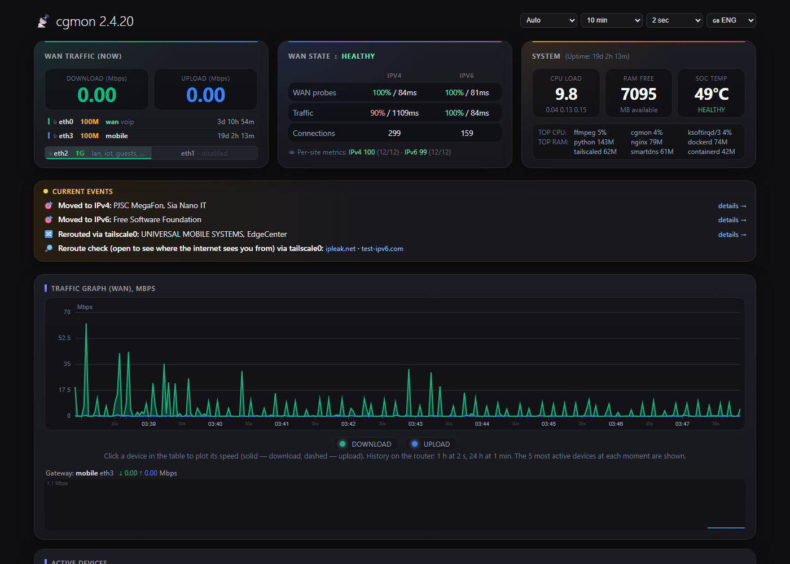
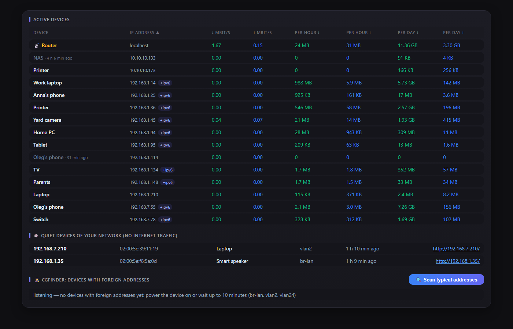
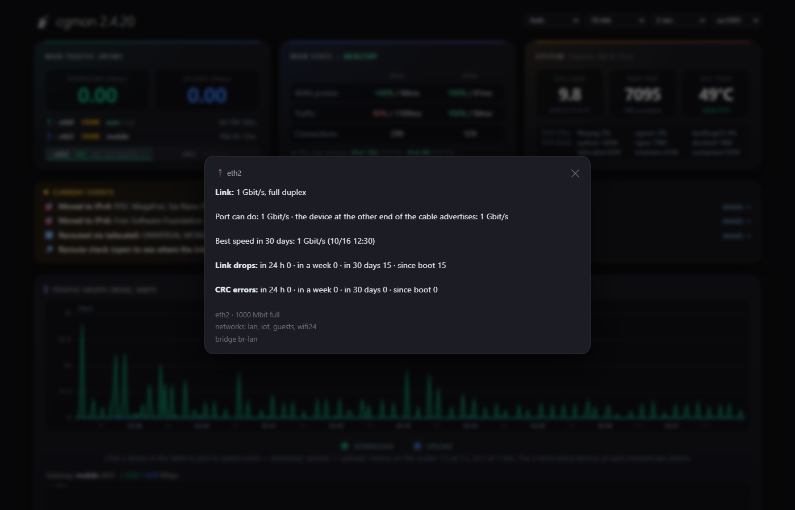
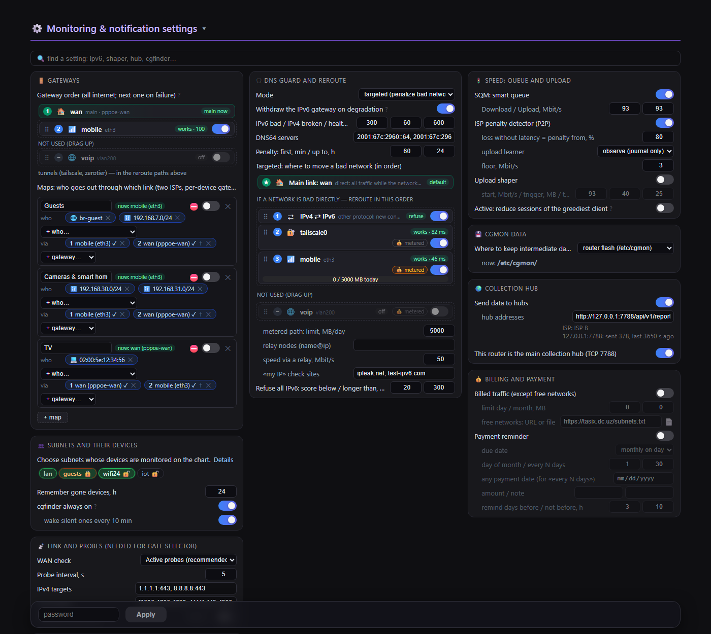
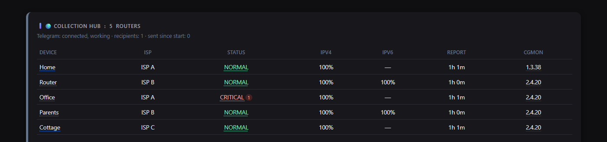
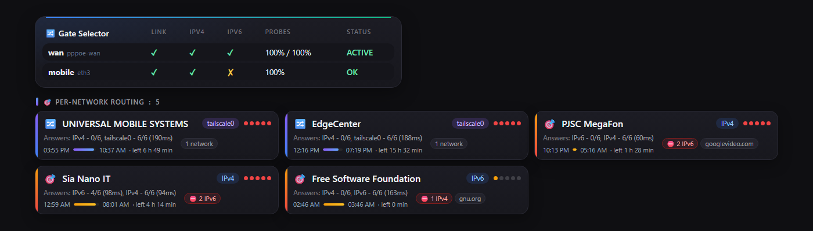
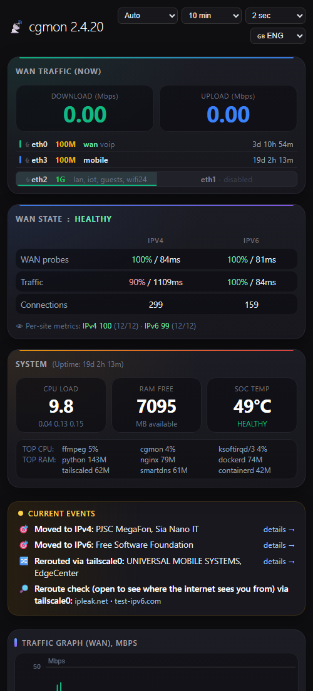

# cgmon

**English** · [Русский](README.ru.md)

A monitor for the internet uplink, conntrack/NAT, devices, switch ports and traffic
on **OpenWrt / ImmortalWrt** routers — including routers behind carrier-grade NAT —
plus a hub that collects failures from many routers. One static binary of
**~2 MB** using **3–5 MB of RAM**, with a web page and Telegram alerts. It runs
even on an old MIPS router with 64 MB of memory. For a plain-language tour, see
[docs/users.md](docs/users.md).



| | | |
|---|---|---|
| [](docs/screenshots/2-devices.png) Devices and cgfinder | [](docs/screenshots/3-ports.png) Port details: link drops, CRC, speed | [](docs/screenshots/7-settings.png) Settings: two networks over two gateways |
| [](docs/screenshots/5-hub.png) Collection hub | [](docs/screenshots/6-routing.png) Gateways and per-network routing | [](docs/screenshots/8-phone.png) On a phone |

> Version 2.x is written in Rust and replaces the 1.x Go version. The config file,
> web page, CGI, socket and hub report format are compatible: a 2.x hub accepts
> reports from 1.x routers.

## The idea: a conductor, not a router

cgmon builds on what the Linux kernel and OpenWrt already provide. **It never
routes traffic and no packet ever passes through it**: the kernel forwards
everything, while cgmon watches and, when the situation calls for it, adds,
changes or removes its own rules:

- **nftables** — its own tables next to the firewall (`inet cgmon` — limiter,
  `inet cgmon_acct` — traffic accounting, `inet cgmon_route` — connection marks
  for rerouting, `inet cgmon_gw` — gateway maps, `inet cgmon_v6` — per-protocol
  refusal). Firewall rules are never edited and the firewall is never reloaded;
- **kernel routing** — `ip rule` entries keyed on connection marks, its own routing
  tables, and `ip route replace` to change the main gateway;
- **tc** — the SQM queue tree and the upload shaper rate;
- **DNS** — only in the protocol-wide mode of the DNS guard (SmartDNS or dnsmasq).
  The targeted mode and rerouting leave the DNS server alone.

It observes through the kernel as well: conntrack and nftables counters over
netlink, copies of SYN/RST packets and DNS answers from an AF_PACKET socket, sysfs
and ethtool ioctls for ports, plus its own probes and TCP traces. One thread with
epoll, no helper processes. If the daemon stops or crashes, connectivity is not
affected: the kernel keeps working with the last rules, and the next start picks
up its tables and state.

## Features

**Uplink and sites**
- **WAN state** — TCP 443 probes over IPv4 and IPv6, NORMAL / WARNING / CRITICAL /
  RECOVERY phases and a readable incident journal.
- **Down detector** — which sites stop answering your clients while the internet
  itself is fine, named by service and network owner (Google, Telegram…) from DNS
  and AS data.
- **Per-site metrics** — IPv4 and IPv6 scored against the sites your clients
  actually use, which tells a protocol-wide failure from trouble with individual
  networks.
- **Culprit search** — when a protocol goes bad, the router TCP-traces good and bad
  sites and names the hop or peering point that all bad paths have in common.

**Ports and cables (physical layer)**
- Link drops (including flaps between polls), speed and duplex changes, CRC, frame
  and FIFO errors for every port; on older swconfig switches — per switch port,
  labelled with its VLAN.
- Graded CRC errors: isolated ones are a warning; 0.01 % of frames, 1000 a day or
  errors together with link drops are critical — the cable is about to fail.
- "Port runs slower than it can" is reported only if it really was faster during
  the last 30 days; the speed advertised by the device at the other end of the
  cable is shown (ethtool).
- Ports right in the WAN card: a badge with today's link drops, a red (blinking
  when critical) name on CRC errors, and a details window on click; plus a line in
  "Current events" and an issue on the hub.

**Devices and traffic**
- **Devices** — live speed, traffic per hour and per day, names from DHCP, mDNS,
  NetBIOS and UPnP, vendor by MAC.
- **Connections** — the number of useful internet connections (clients, router
  services, Tailscale, ZeroTier) without cgmon's own probes; the total is in the
  tooltip and in the incident journal, because the ISP's CGNAT limit counts them
  all.
- **The chart** is built from one consistent snapshot: WAN, router and per-device
  byte counters are read at the same moment, so the devices add up to the WAN total
  and hovering over a spike shows who caused it. History is kept on the router (one
  hour at 2 s, one day at 1 min), so the page shows 10 minutes … 24 hours right
  away.
- **cgfinder** (like MikroTik's IP Scan) — devices with an address outside your
  networks (an old camera with a static IP, 169.254.x.x), quiet devices that never
  go online, and "Open access": for one hour the router takes an address in the
  device's network so you can reach it. Runs for 30 minutes on demand.
- **Traffic accounting** with nftables counters; billed traffic is everything
  except free networks (TAS-IX or your own list).
- **Tenants** — isolated subnets see only their own devices on the page.

**Actions**
- **Gateway maps** — which LAN clients use which way out: a subnet, VLAN or single
  device → gateways in order (WAN links, a Tailscale exit node, your own routers
  over ZeroTier), falling back to the next one on failure. This is how you get
  "two ISPs" or "the TV goes through another router"; open connections never move.
- **Gateway selector** — gateways are discovered automatically (netifd: default
  routes, the wan zone; PPPoE, DHCP, LTE modems); the main one has the lowest
  metric, backups follow in order. It only observes by default and sleeps when
  there is a single gateway.
- **DNS guard** — when one protocol is bad for one network owner, new connections
  over it are refused at once (clients instantly fall back to the other protocol)
  or rerouted through another link. Penalties grow on repeat offences and are
  lifted early as soon as a check comes back clean; both protocols of one owner are
  never blocked.
- **SQM and an upload shaper**, a detector of ISP penalties for P2P traffic, and a
  limiter of new connections for the greediest client (observe-only by default).

**Collection hub**
- Routers report their state to one or more hubs over an encrypted channel
  (AES-256-GCM; the token never travels over the network). The hub tells "my ISP
  is broken" from "the upstream link is down" and notifies you in Telegram.
- **Router health**: a router's status on the hub is the worst of its WAN phase and
  its own issues (ports, backup link, overheating, mass failures…); click it for
  details. The router name links to its page, the version opens an info window
  with "Remove from hub"; routers silent for 30 days are forgotten automatically.

**The page**
- One-line current events, a chart that highlights who caused a spike, ports in
  the WAN card, settings applied live without a restart (password-protected, with
  brute-force protection), settings search and plugins (a page block plus settings
  in a file).
- Interface languages: English and Russian, with partial Uzbek, Kazakh and Chinese;
  the language is picked from the browser. Journal messages, setting hints and the
  CLI are currently in Russian.

## Builds: full, lite, nano

One code base, three builds. Whatever is missing on the router at run time (a
package is not installed) simply does not start and does not get in the way of the
rest: the setting is greyed out on the page with "requires …" and an "install"
link, and "Current events" shows a 📦 line with an **Install** button (apk/opkg on
the router, password-protected, with a free-flash check). cgmon configures ZeroTier
and SmartDNS installed this way on its own, and safely: ZeroTier is only started
(you join your network yourself; the public Earth network is never joined), and
SmartDNS is set up with encrypted DNS, with dnsmasq switched over only if SmartDNS
answers — otherwise everything is put back. Anything already configured is left
untouched.

| Feature | full | lite | nano | Packages (≈ KB on mips_24kc) |
|---|:-:|:-:|:-:|---|
| WAN state, incidents, down detector, per-site metrics, culprit search | ✅ | ✅ | ✅ | — |
| Devices, chart with history, accounting and billed traffic, cgfinder | ✅ | ✅ | ✅ | — |
| Ports and cables (CRC, link drops, speed), swconfig | ✅ | ✅ | ✅ | — |
| Gateway selector with switching, gateway maps | ✅ | ✅ | ✅ | — (busybox `ip` is enough) |
| DNS guard, protocol-wide mode (no AAAA, DNS64, IPv6 gateway withdrawal) | ✅ | ✅ | ✅ | — (dnsmasq, odhcpd) |
| Collection hub, reports, Telegram, LuCI page | ✅ | ✅ | ✅ | — (uclient-fetch + libustream) |
| SQM with cake, upload shaper | ✅ | ✅ | ✅ | `tc-tiny`, `kmod-sched-cake`, `kmod-sched-core`, `kmod-ifb` (≈240) |
| Hard connection limits | ✅ | ✅ | — | `kmod-nft-connlimit` (≈10) |
| Your own routers as map gateways (ZeroTier) | ✅ | ✅ | — | `zerotier` (≈1150 incl. libstdc++) |
| curl for HTTPS | ✅ | ✅ | — | `curl` (≈350) |
| Targeted DNS guard, rerouting, per-network IPv6 refusal | ✅ | — | — | `smartdns` (≈200), `ip-full` (≈400), `curl` |
| Download size, MB | 2.0–3.1 (plain) | 0.85–0.99 (UPX) | 0.85–0.99 (UPX) | |

Unpacked, the three builds differ by only a few kilobytes; what sets them apart is
which packages they need on the router and what they offer to install. lite and
nano ship UPX-packed to save flash.

- **full** — everything; for x86 and powerful ARM routers.
- **lite** — everything except SmartDNS and what depends on it (targeted mode,
  rerouting). Moderate packages — curl, ZeroTier, tc — are one click away.
- **nano** — for weak routers with little flash (e.g. TP-Link TL-WR1043N/ND v4 on
  ImmortalWrt 25.12): everything runs on the stock image (nftables, dnsmasq-full,
  busybox, swconfig, uclient-fetch). The only optional extra is SQM with cake
  (≈240 KB) — ISP-supplied routers often pair a strong CPU with tiny flash.

`cgmon --version` shows the build ("2.4.21 lite"); the page shows it next to the
version.

## Resources

| Router | cgmon CPU | Memory |
|---|---|---|
| x86 Celeron J1900, 40+ devices, hub, DNS guard, QoS, page open | ~2.9 % of a core | ~5 MB |
| x86 Celeron J1900, gateway with ports and a switch, port watch always on | ~0.7 % of a core | ~2.6 MB |
| TP-Link TL-WR1043ND v3 (MIPS 74Kc 720 MHz, 64 MB), switch | ~0.8 % of a core | ~3 MB |

Only the binary lives on flash: the page and CGI scripts are embedded in it
compressed and unpacked to `/tmp/cgmon/www` at start (`/www` gets symlinks). The
MIPS binary with the page inside is 3.0 MB, or 0.93 MB packed with UPX. All
temporary files live in `/tmp/cgmon`. Where accumulated data (accounting, metrics…)
is kept is a setting: router flash (`/etc/cgmon`), RAM (`/tmp`) or a USB stick/disk.

A disabled feature allocates no memory and uses no CPU; on a weak router the
expensive page blocks (ports, TOP CPU/RAM) are turned on with a button.

## Requirements

OpenWrt / ImmortalWrt with nftables (`nft`; on an old firewall3 system installing
the `nftables` package is enough — the firewall is not touched). Architectures:
x86_64, aarch64, MIPS 24Kc and anything else Rust can target.

Packages per feature are listed in the builds table above; a router used as a map
gateway over ZeroTier must forward from ZeroTier to its WAN. The page (the
"Install" button) or `cgmon deps` shows what is missing; `cgmon deps --install`
installs it from the command line.

## Installation

### Which file to download

Every [release](https://github.com/real4root/cgmon/releases) has three builds for
seven architectures — as plain binaries and as packages. The lite and nano builds
are packed with UPX (≈1 MB): routers usually have far more RAM than flash, and the
binary unpacks itself into memory at start.

| Your router (`DISTRIB_ARCH` in `/etc/openwrt_release`) | Typical targets | File suffix |
|---|---|---|
| `x86_64` | x86/64 | `x86_64` |
| `i386_pentium4` | x86/generic | `i686` |
| `aarch64_*` | mediatek/filogic, qualcommax, rockchip, bcm27xx | `aarch64` |
| `arm_cortex-a7/a9/a15…` | ipq40xx, ipq806x, mvebu, sunxi | `armv7` |
| `arm_arm926ej-s`, `arm_xscale`, `arm_mpcore` | kirkwood, oxnas | `armv5te` |
| `mips_24kc` | ath79 (TP-Link TL-WR1043ND and friends) | `mips` |
| `mipsel_24kc` | ramips mt7621, mt76x8 | `mipsel` |

### From a package

OpenWrt / ImmortalWrt 25.x (apk):

```sh
apk add --allow-untrusted /tmp/cgmon-lite-<version>-r1-<arch>.apk
```

OpenWrt 24.10 and older (opkg):

```sh
opkg install /tmp/cgmon-lite_<version>-1_<arch>.ipk
```

The package installs `/opt/cgmon/cgmon` and the `/etc/init.d/cgmon` service,
creates a minimal config (all defaults — observe only) if there is none, and starts
the service. A package for the wrong CPU refuses to install. The packages are not
signed, hence `--allow-untrusted`; checksums are in `SHA256SUMS`. Packages of
different builds (`cgmon`, `cgmon-lite`, `cgmon-nano`) replace each other only after
removing the old one.

### From a binary

```sh
scp cgmon root@router:/tmp/cgmon       # the binary for your architecture (uname -m)
ssh root@router /tmp/cgmon --install   # wizard: minimal, basic or detailed setup
```

`--install-min` asks only for the page password, `--install-basic` also covers the
hub, Telegram, traffic accounting and gateways, and `--advanced-install` walks
through every option. Anything that can be changed on the page is not asked. The
wizard writes `/etc/cgmon/cgmon.yaml` (an existing file is edited in place, with
comments preserved), installs the service and starts it.

The page installs itself: it is embedded in the binary (`web.embedded`) and lives
at `http://<router>/status.html`. To remove cgmon, run `cgmon --uninstall` (removes
the service and page links; config and data in `/etc/cgmon` stay).

The page password, hub and Telegram are set in LuCI under **Services → cgmon**
(cgmon installs this LuCI page itself when LuCI is present). Without a password the
monitoring page is read-only.

To check: `cgmon status`, `cgmon top`, `cgmon ports`, `cgmon sites`,
`logread | grep cgmon`.

## Secure by default

The default config blocks nothing, shapes nothing and sends nothing anywhere — it
only observes. Settings can be changed from the page only with the password (five
wrong attempts trigger a pause); **with no password set, the page is read-only** and
nothing can be changed from it. The password and hub are set in LuCI ("Services →
cgmon"), in the wizard or in `cgmon.yaml` (mode 0600); secrets are never sent to the
page. Everything that comes from outside (device names, DNS, reports) is size-bound
and escaped, and the parsers of external data are covered by fuzz-style tests.

## Documentation

- [docs/users.md](docs/users.md) — what cgmon does, in plain language.
- `cgmon --help`, `cgmon --help-advanced` — commands, files, ports, examples.
- [config.reference.yaml](config.reference.yaml) — every option with an explanation
  (comments in Russian).
- [docs/hub.md](docs/hub.md) — the collection hub, TCP port 7788, security, Telegram.

## Building

You need Rust (rustup); the musl linker is `rust-lld` (x86_64, aarch64) or zig
(MIPS).

```sh
cargo test  --release --target x86_64-unknown-linux-musl
cargo build --release --target x86_64-unknown-linux-musl
cargo build --release --target aarch64-unknown-linux-musl
# MIPS 24Kc (ath79/ramips, OpenWrt mips_24kc): std is built from source
cargo +nightly build --release -Z build-std=std,panic_abort --target mips-unknown-linux-musl
```

The default build is full; for lite and nano use `--no-default-features --features
lite` (or `nano`). `tools/mkrelease2.sh` builds all three for all three
architectures.

Dependencies: `libc`, `aes-gcm`, `sha2`. No tokio, serde or regex: a single thread
with epoll, hand-written JSON, nftables counters over netlink. A per-component CPU
and memory profile is available with `cargo build --features prof` and
`cgmon prof`.

## License

GNU General Public License v3.0 or later — see [LICENSE](LICENSE). You are free to
use, study, modify and share it; modified versions must be distributed under the
same license, with source code.
