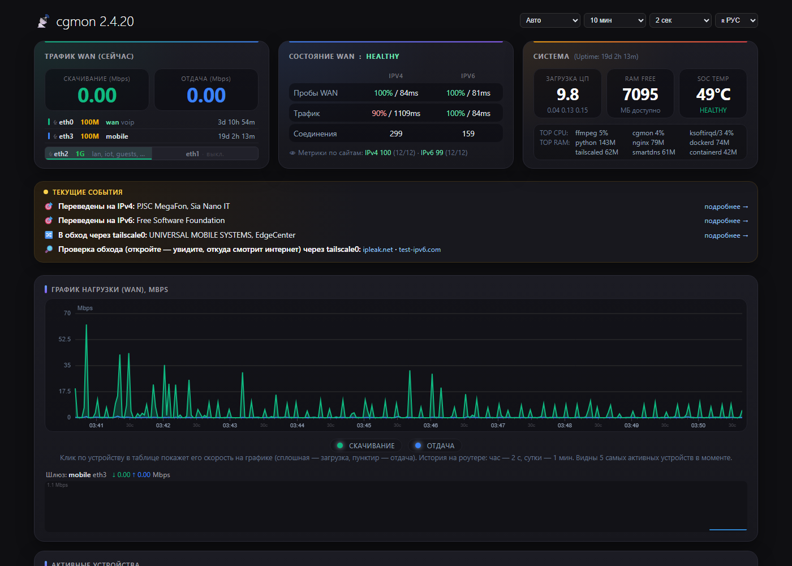
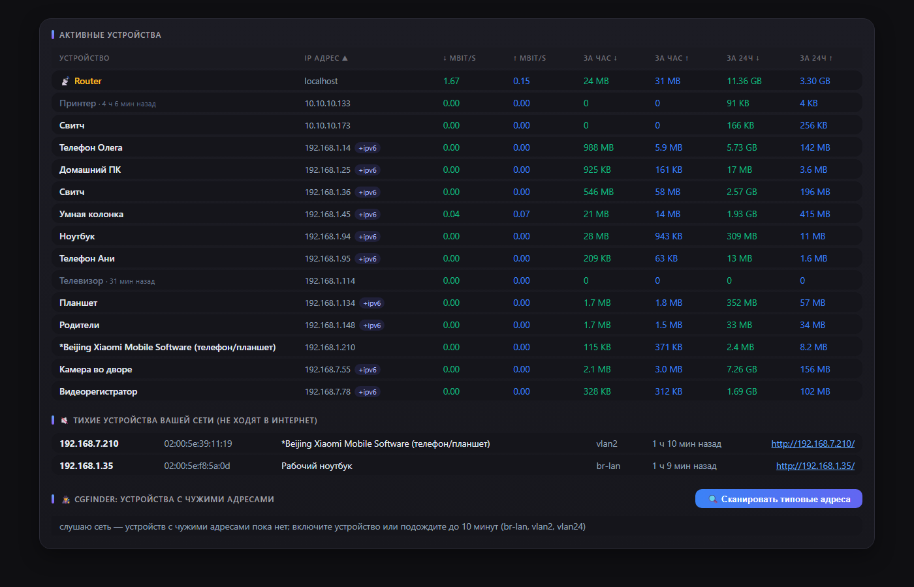
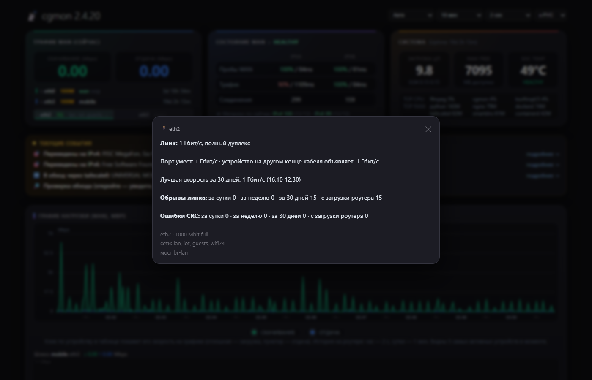
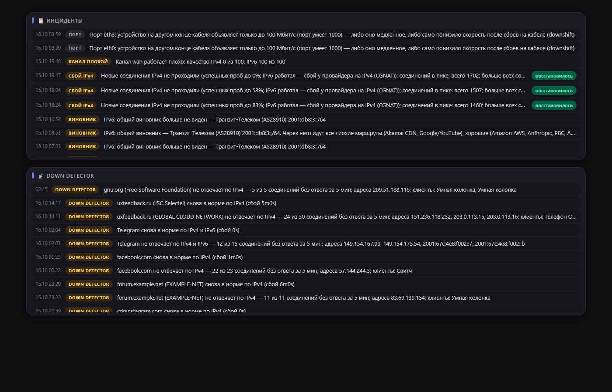
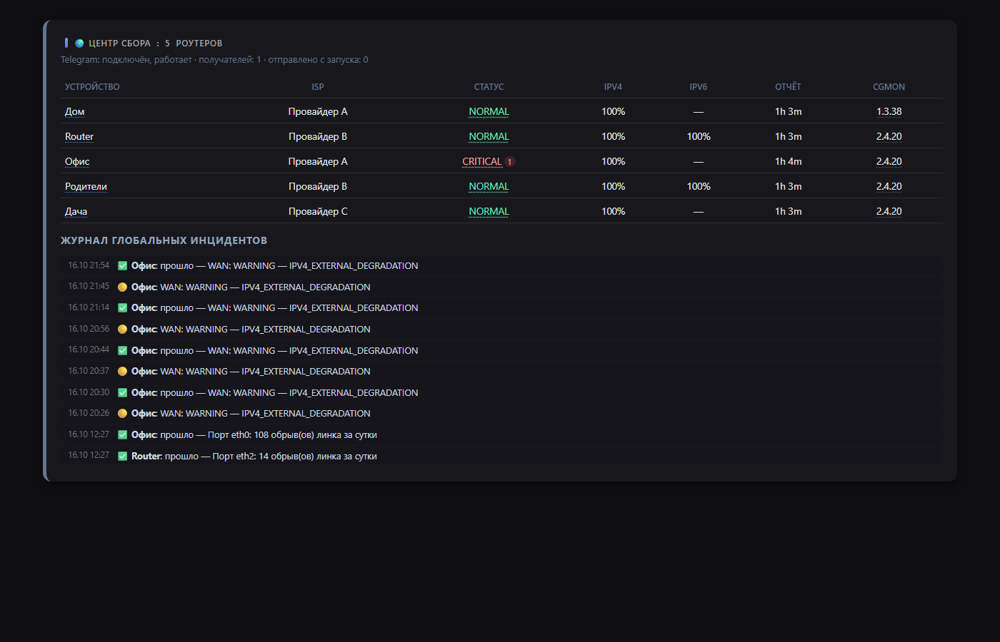
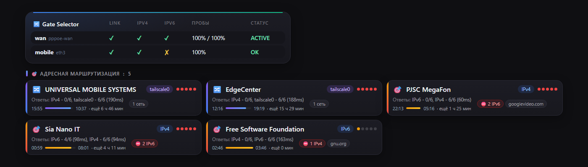
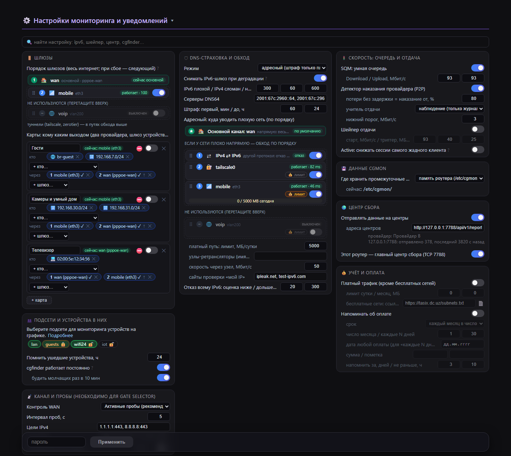
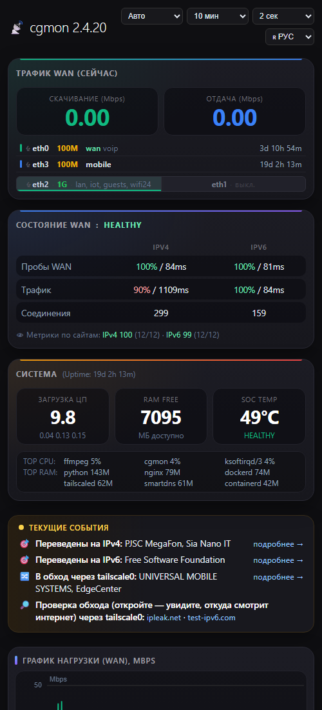

# cgmon

[English](README.md) · **Русский**

Монитор внешнего канала, conntrack/NAT, устройств, портов и трафика для роутеров
**OpenWrt / ImmortalWrt** (в том числе за CGNAT провайдера) и центр сбора сбоев
с нескольких роутеров. Один статический бинарник **~2 МБ**, **3–5 МБ памяти**,
веб-страница и уведомления в Telegram. Работает даже на старом MIPS-роутере с
64 МБ памяти. Простыми словами — [docs/users.ru.md](docs/users.ru.md).



| | | |
|---|---|---|
| [](docs/screenshots/ru/2-devices.png) Устройства и cgfinder | [](docs/screenshots/ru/3-ports.png) Порт: обрывы, CRC, скорость | [](docs/screenshots/ru/4-incidents.png) Инциденты и down detector |
| [](docs/screenshots/ru/5-hub.png) Центр сбора | [](docs/screenshots/ru/6-routing.png) Шлюзы и адресная маршрутизация | [](docs/screenshots/ru/7-settings.png) Настройки: две сети через два шлюза |
| [](docs/screenshots/ru/8-phone.png) На телефоне | | |

> Версия 2.x написана на Rust и заменяет 1.x на Go. Конфиг, страница, CGI, сокет
> и формат отчётов на центр совместимы: центр 2.x принимает отчёты 1.x.

## Как это устроено

cgmon — надстройка над тем, что уже есть в ядре Linux и в OpenWrt. **Сам он
трафик не маршрутизирует и через себя не пропускает**: пакеты пересылает ядро,
а cgmon наблюдает и по ситуации добавляет, меняет и убирает свои правила:

- **nftables** — свои таблицы рядом с firewall (`inet cgmon` — лимитер,
  `inet cgmon_acct` — учёт трафика, `inet cgmon_route` — метки соединений для
  обхода, `inet cgmon_gw` — карты шлюзов, `inet cgmon_v6` — отказ по протоколу).
  Правила firewall не правятся, firewall не перезагружается;
- **маршрутизация ядра** — `ip rule` по меткам соединений и свои таблицы маршрутов;
  смена основного шлюза — `ip route replace`;
- **tc** — дерево очередей SQM и скорость шейпера отдачи;
- **DNS** — только в общем режиме DNS-страховки (SmartDNS или dnsmasq). Адресный
  режим и обход DNS-сервер не трогают.

Смотрит cgmon тоже средствами ядра: conntrack и счётчики nftables через netlink,
копии SYN/RST и DNS-ответов с сокета AF_PACKET, sysfs и ethtool-ioctl портов,
собственные пробы и TCP-трассировки. Один поток и epoll, без лишних процессов.
Остановка или падение демона связь не рвёт: ядро работает по последним правилам,
а следующий запуск подхватывает свои таблицы и состояние.

## Что умеет

**Канал и сайты**
- **Состояние WAN** — пробы TCP 443 (IPv4/IPv6), фазы NORMAL / WARNING / CRITICAL /
  RECOVERY, понятный журнал инцидентов.
- **Down detector** — какие сайты не отвечают клиентам, пока сам интернет в
  порядке; имя сервиса и владелец сети (Google, Telegram…) по DNS и AS.
- **Метрики по сайтам** — оценка IPv4/IPv6 баллами по сайтам, которыми реально
  пользуются клиенты: отличает сбой всего протокола от сбоя отдельных сетей.
- **Поиск виновника** — при плохом протоколе роутер трассирует TCP до плохих и
  хороших сайтов и называет узел или стык, через который идут все плохие маршруты.

**Порты и кабели (физический уровень)**
- Обрывы линка (и «мигание» между опросами), смена скорости и дуплекса, ошибки
  CRC/кадров/FIFO — по каждому порту; на старых свитчах swconfig — по портам
  свитча с подписью VLAN.
- Ошибки CRC по уровням: единичные — предупреждение; от 0,01 % кадров, от 1000 за
  сутки или вместе с обрывами линка — критично (кабель вот-вот откажет).
- «Порт работает медленнее» — только если за последние 30 дней он реально работал
  быстрее; видно, что объявляет устройство на другом конце кабеля (ethtool).
- Порты прямо в карточке WAN: значок обрывов за сутки, имя красным при CRC
  (критично — мигает), по нажатию — окно с подробностями; строка в «Текущих
  событиях», проблема на центре сбора.

**Устройства и трафик**
- **Устройства** — скорости, трафик за час/сутки, имена из DHCP, mDNS, NetBIOS,
  UPnP, производитель по MAC.
- **Соединения** — число полезных соединений в интернет (клиенты, службы роутера,
  Tailscale, ZeroTier) без служебных проб cgmon; общее число — в подсказке и в
  журнале сбоев: лимит провайдера (CGNAT) считает все.
- **График** строится из одного согласованного снимка: байты WAN, роутера и всех
  устройств читаются в один момент, поэтому сумма устройств сходится с WAN, и
  наведение на пик показывает, кто его дал. История хранится на роутере (час по 2 с,
  сутки по минуте): открыл страницу — сразу виден график за 10 минут… 24 часа.
- **cgfinder** (как IP Scan в MikroTik) — устройства с адресом не из вашей сети
  (старая камера со статическим IP, 169.254.x.x), тихие устройства, «Открыть
  доступ» — роутер на час берёт адрес в сети устройства. По кнопке на 30 минут.
- **Учёт трафика** через счётчики nftables, платный трафик — всё, кроме
  бесплатных сетей (TAS-IX или свой список).
- **Квартиранты** — выделенные подсети видят на странице только свои устройства.

**Действия**
- **Карты шлюзов** — кто из LAN каким выходом в интернет ходит: подсеть, VLAN или
  отдельное устройство → шлюзы по порядку (WAN-каналы, tailscale exit node, свои
  роутеры в ZeroTier), при сбое — следующий. Так делаются «два провайдера» и
  «телевизор через другой роутер»; уже открытые соединения не переезжают.
- **Выбор шлюза** — шлюзы находятся сами (netifd: маршрут по умолчанию, зона wan;
  PPPoE, DHCP, LTE-модем), основной — с наименьшей метрикой, резервные — по порядку;
  по умолчанию только наблюдает, при одном шлюзе спит.
- **DNS-страховка** — плохой протокол у сети одного владельца: новым соединениям
  по нему сразу отказ (клиент мгновенно уходит на другой протокол) или обход
  через другой канал. Штраф растёт при повторах и снимается досрочно, как только
  проверка чистая; оба протокола одного владельца не закрываются никогда.
- **SQM и шейпер отдачи**, детектор наказаний провайдера за P2P, лимитер новых
  соединений самого жадного клиента (по умолчанию — только наблюдение).

**Центр сбора**
- Роутеры шлют состояние на один или несколько центров по зашифрованному каналу
  (AES-256-GCM, токен по сети не передаётся). Центр отличает «сломался мой
  провайдер» от «лёг внешний канал», пишет в Telegram.
- **Здоровье роутера**: статус на центре — худшее из фазы WAN и проблем роутера
  (порты, резервный канал, перегрев, массовые сбои…); нажатие на статус — окно с
  описаниями. Имя роутера — ссылка на его страницу, версия — окно сведений и
  «Убрать с центра»; молчащих 30 дней центр забывает сам.

**Страница**
- Текущие события одной строкой, график с подсветкой «кто в пике», порты в
  карточке WAN, настройки со страницы без перезапуска (с паролем и защитой от
  перебора), поиск по настройкам, плагины (блок страницы + настройки в файле).

## Сборки: full, lite, nano

Один исходный код, три сборки. Чего нет на роутере во время работы (пакет не
стоит), не запускается и не мешает остальному: настройка на странице серая с
пометкой «требуется …» и ссылкой «установить», а в «Текущих событиях» — строка 📦
с кнопкой **Установить** (apk/opkg на роутере, по паролю, с проверкой места на
flash). Поставленные так ZeroTier и SmartDNS cgmon настраивает сам, безопасно:
ZeroTier только запускается (в сеть вступаете вы, публичная сеть Earth не
подключается), SmartDNS — шифрованный DNS, и dnsmasq переводится на него только
если он отвечает (иначе всё возвращается как было). Уже настроенное не трогается.

| Возможность | full | lite | nano | Пакеты (≈ КБ на mips_24kc) |
|---|:-:|:-:|:-:|---|
| Состояние WAN, инциденты, down detector, метрики по сайтам, поиск виновника | ✅ | ✅ | ✅ | — |
| Устройства, график с историей, учёт и платный трафик, cgfinder | ✅ | ✅ | ✅ | — |
| Порты и кабели (CRC, обрывы, скорость), swconfig | ✅ | ✅ | ✅ | — |
| Выбор шлюза с переключением, карты шлюзов | ✅ | ✅ | ✅ | — (хватает `ip` из busybox) |
| DNS-страховка, общий режим (запрет AAAA, DNS64, снятие IPv6-шлюза) | ✅ | ✅ | ✅ | — (dnsmasq, odhcpd) |
| Центр сбора, отчёты, Telegram, LuCI-страница | ✅ | ✅ | ✅ | — (uclient-fetch + libustream) |
| SQM на cake, шейпер отдачи | ✅ | ✅ | ✅ | `tc-tiny`, `kmod-sched-cake`, `kmod-sched-core`, `kmod-ifb` (≈240) |
| Жёсткие лимиты соединений | ✅ | ✅ | — | `kmod-nft-connlimit` (≈10) |
| Свои роутеры как шлюзы карт (ZeroTier) | ✅ | ✅ | — | `zerotier` (≈1150 с libstdc++) |
| curl для HTTPS | ✅ | ✅ | — | `curl` (≈350) |
| Адресная DNS-страховка, обход маршрутом, отказ IPv6 по сетям | ✅ | — | — | `smartdns` (≈200), `ip-full` (≈400), `curl` |
| Размер файла, МБ | 2,0–3,1 (без сжатия) | 0,85–0,99 (UPX) | 0,85–0,99 (UPX) | |

Без сжатия сборки отличаются на единицы КБ — разница в том, какие пакеты им нужны
на роутере и что они предложат доставить. lite и nano выкладываются сжатыми UPX,
чтобы экономить flash.

- **full** — всё, для x86 и сильных ARM-роутеров.
- **lite** — без SmartDNS (и всего, что на нём держится: адресный режим, обход
  маршрутом). Умеренные пакеты — curl, ZeroTier, tc — ставятся кнопкой.
- **nano** — для слабых роутеров с маленькой flash (например, TP-Link
  TL-WR1043N/ND v4 на ImmortalWrt 25.12): всё работает на штатном образе
  (nftables, dnsmasq-full, busybox, swconfig, uclient-fetch); единственное, что
  можно доставить, — SQM на cake (≈240 КБ): на роутерах от провайдеров часто
  сильный процессор и мало flash.

`cgmon --version` показывает сборку («2.4.22 lite»), на странице она рядом с версией.

## Ресурсы

| Роутер | CPU cgmon | Память |
|---|---|---|
| x86 Celeron J1900, 40+ устройств, центр сбора, DNS-страховка, QoS, страница открыта | ~2,9 % ядра | ~5 МБ |
| x86 Celeron J1900, шлюз с портами и свитчем, наблюдение за портами всегда включено | ~0,7 % ядра | ~2,6 МБ |
| TP-Link TL-WR1043ND v3 (MIPS 74Kc 720 МГц, 64 МБ), свитч | ~0,8 % ядра | ~3 МБ |

На flash — только бинарник: страница и CGI встроены в него сжатыми и при запуске
распаковываются в `/tmp/cgmon/www` (в `/www` — ссылки). MIPS со страницей внутри —
3,0 МБ, сжатый UPX — 0,93 МБ. Все временные файлы — в `/tmp/cgmon`. Где держать
накопленные данные (учёт, метрики…), выбирается в настройках: память роутера
(`/etc/cgmon`), оперативная память (`/tmp`) или USB-флешка/диск.

Выключенная функция не выделяет память и не тратит процессор; на слабом роутере
дорогие блоки страницы (порты, TOP CPU/RAM) включаются по кнопке.

## Требования

OpenWrt / ImmortalWrt с nftables (`nft`; на старом firewall3 достаточно
поставить пакет `nftables` — firewall он не трогает). Архитектуры: x86_64,
aarch64, MIPS 24Kc и другие, под которые собирается Rust.

Пакеты по функциям — в таблице сборок выше; на узле, через который ходят карты
(свой роутер в ZeroTier), нужна пересылка из ZeroTier в его WAN. Чего не хватает —
покажет страница (кнопка «Установить») или `cgmon deps`; `cgmon deps --install`
поставит из командной строки.

## Установка

### Какой файл скачать

В каждом [релизе](https://github.com/real4root/cgmon/releases) — три сборки под семь
архитектур: бинарники и пакеты. Сборки lite и nano сжаты UPX (≈1 МБ): оперативной
памяти у роутеров обычно намного больше, чем flash, а бинарник сам распаковывается
в память при запуске.

| Ваш роутер (`DISTRIB_ARCH` в `/etc/openwrt_release`) | Типичные платформы | Окончание файла |
|---|---|---|
| `x86_64` | x86/64 | `x86_64` |
| `i386_pentium4` | x86/generic | `i686` |
| `aarch64_*` | mediatek/filogic, qualcommax, rockchip, bcm27xx | `aarch64` |
| `arm_cortex-a7/a9/a15…` | ipq40xx, ipq806x, mvebu, sunxi | `armv7` |
| `arm_arm926ej-s`, `arm_xscale`, `arm_mpcore` | kirkwood, oxnas | `armv5te` |
| `mips_24kc` | ath79 (TP-Link TL-WR1043ND и подобные) | `mips` |
| `mipsel_24kc` | ramips mt7621, mt76x8 | `mipsel` |

### Пакетом

OpenWrt / ImmortalWrt 25.x (apk):

```sh
apk add --allow-untrusted /tmp/cgmon-lite-<версия>-r1-<арх>.apk
```

OpenWrt 24.10 и старше (opkg):

```sh
opkg install /tmp/cgmon-lite_<версия>-1_<арх>.ipk
```

Пакет ставит `/opt/cgmon/cgmon` и службу `/etc/init.d/cgmon`, создаёт минимальный
конфиг (всё по умолчанию — только наблюдение), если его нет, и запускает службу.
Пакет под чужой процессор не поставится. Пакеты не подписаны, отсюда
`--allow-untrusted`; контрольные суммы — в `SHA256SUMS`. Пакеты разных сборок
(`cgmon`, `cgmon-lite`, `cgmon-nano`) меняются друг на друга только через удаление
старого.

### Бинарником

```sh
scp cgmon root@router:/tmp/cgmon       # бинарник под свою архитектуру (uname -m)
ssh root@router /tmp/cgmon --install   # мастер: минимальная, обычная или подробная настройка
```

`--install-min` спрашивает только пароль страницы, `--install-basic` — ещё центр
сбора, Telegram, учёт трафика и шлюзы, `--advanced-install` — все параметры.
Всё, что меняется на странице, мастер не спрашивает. Он пишет
`/etc/cgmon/cgmon.yaml` (существующий файл правится на месте, комментарии
сохраняются), ставит службу и запускает её.

Страница ставится сама: она внутри бинарника (`web.embedded`), адрес —
`http://<роутер>/status.html`. Удаление: `cgmon --uninstall` (служба и ссылки
страницы; конфиг и данные в `/etc/cgmon` остаются).

Пароль страницы, центр сбора и Telegram — в LuCI: **Службы → cgmon** (страницу LuCI
cgmon ставит сам, если на роутере есть LuCI). Без пароля страница мониторинга
только показывает.

Проверка: `cgmon status`, `cgmon top`, `cgmon ports`, `cgmon sites`, `logread | grep cgmon`.

## Безопасность по умолчанию

Конфиг по умолчанию ничего не блокирует, не шейпит и никуда не отправляет —
только наблюдает. Изменение настроек со страницы — только по паролю (5 неверных —
пауза); **пароль не задан — страница только показывает**, менять с неё нельзя
ничего. Пароль и центр сбора задаются в LuCI («Службы → cgmon»), мастером или в
`cgmon.yaml` (0600); секреты на страницу не выводятся.
Всё, что пришло извне (имена устройств, DNS, отчёты), ограничено по размеру и
экранируется; парсеры внешних данных покрыты тестами на мусор.

## Документация

- [docs/users.ru.md](docs/users.ru.md) — что умеет cgmon, простыми словами.
- `cgmon --help`, `cgmon --help-advanced` — команды, файлы, порты, примеры.
- [config.reference.yaml](config.reference.yaml) — все параметры с пояснениями.
- [docs/hub.ru.md](docs/hub.ru.md) — центр сбора, порт TCP 7788, безопасность, Telegram.

## Сборка

Нужен Rust (rustup); линкер для musl — `rust-lld` (x86_64, aarch64) или zig (MIPS).

```sh
cargo test  --release --target x86_64-unknown-linux-musl
cargo build --release --target x86_64-unknown-linux-musl
cargo build --release --target aarch64-unknown-linux-musl
# MIPS 24Kc (ath79/ramips, OpenWrt mips_24kc): std собирается из исходников
cargo +nightly build --release -Z build-std=std,panic_abort --target mips-unknown-linux-musl
```

Сборка по умолчанию — full; lite и nano: `--no-default-features --features lite`
(или `nano`). `tools/mkrelease2.sh` собирает все три под три архитектуры.

Зависимости: `libc`, `aes-gcm`, `sha2`. Без tokio, serde и regex: один поток с
epoll, JSON пишется вручную, счётчики nftables — через netlink. Профиль CPU и
памяти по компонентам — `cargo build --features prof` и `cgmon prof`.

## Сборка пакета OpenWrt

Пакет OpenWrt (варианты `cgmon`, `cgmon-lite`, `cgmon-nano`) лежит в
[openwrt/package/cgmon](openwrt/package/cgmon) и устроен как в фиде `packages`
(использует `lang/rust/rust-package.mk`). В buildroot или SDK OpenWrt с фидом
`packages`:

```sh
cp -r openwrt/package/cgmon feeds/packages/net/cgmon
./scripts/feeds update -i packages && ./scripts/feeds install cgmon
make menuconfig                  # Network → Network monitoring → cgmon / cgmon-lite / cgmon-nano
make package/cgmon/compile V=s
```

Пакет ставит `/usr/sbin/cgmon`, службу procd и минимальный `/etc/cgmon/cgmon.yaml`
(conffile — при обновлении сохраняется).

## Лицензия

GNU General Public License v3.0 или новее — [LICENSE](LICENSE). Можно свободно
пользоваться, изучать, менять и распространять; изменённые версии распространяются
под той же лицензией и с исходным кодом.
