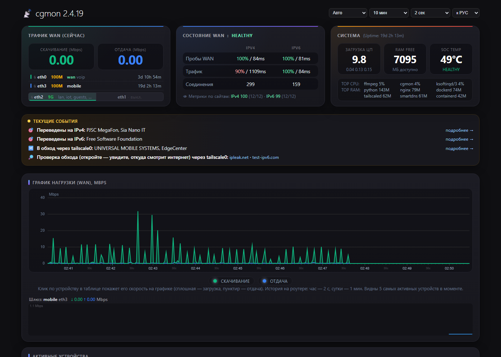
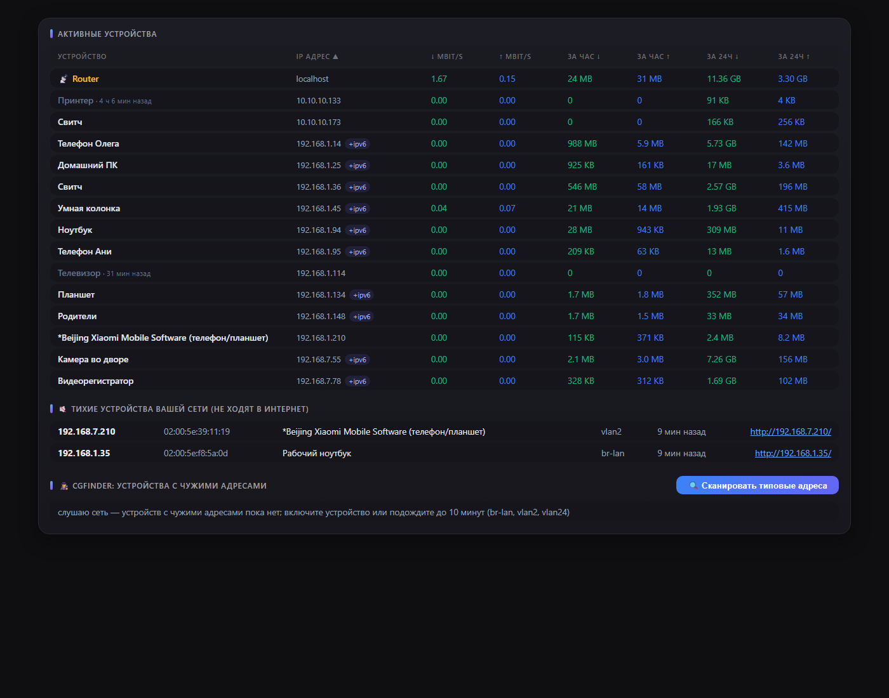
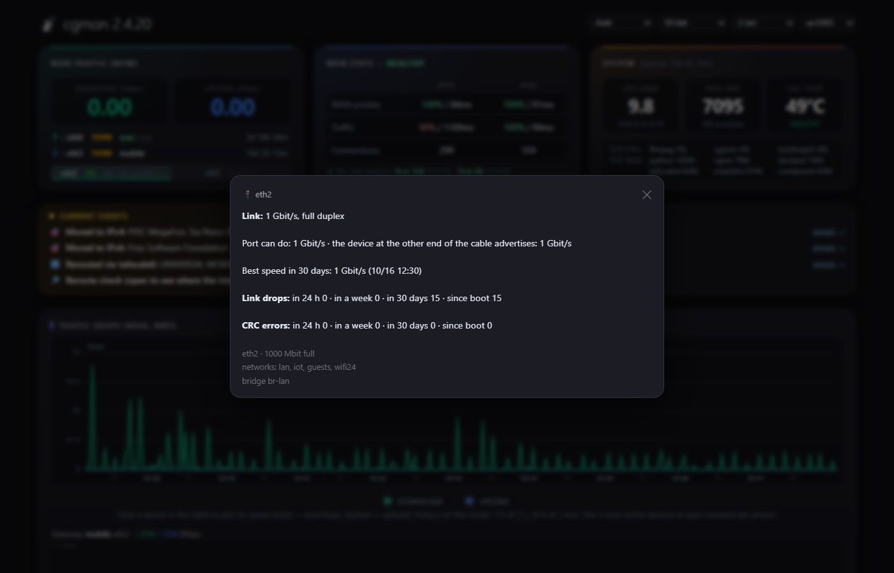
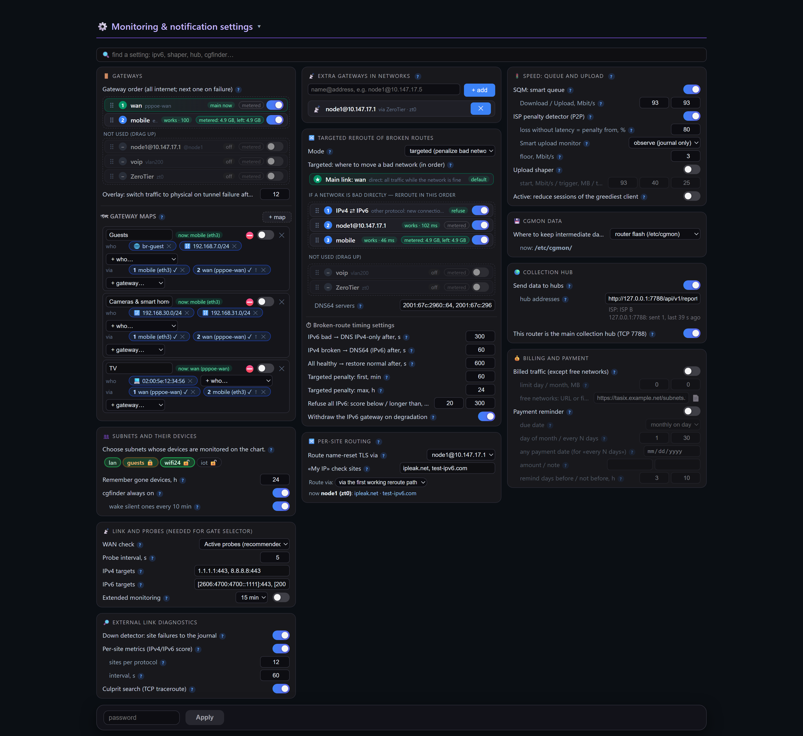
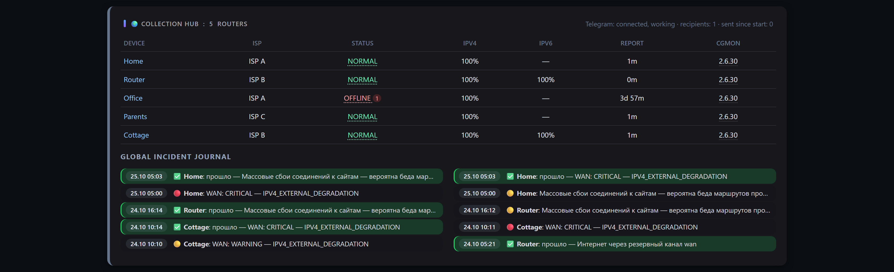
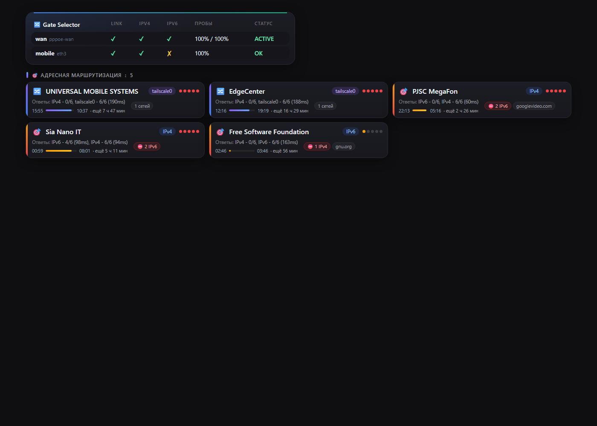
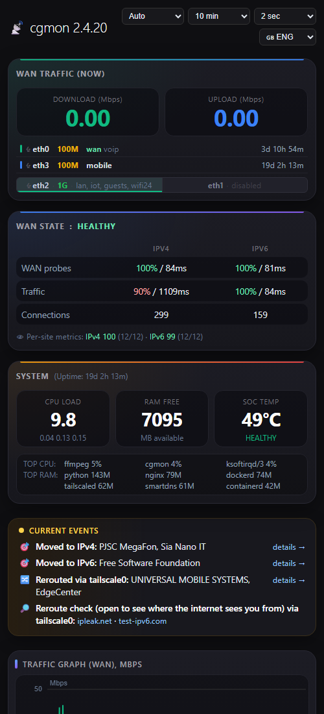

# cgmon

[English](README.md) · [Русский](README.ru.md) · **Oʻzbekcha** · [Қазақша](README.kk.md) · [中文](README.zh.md)

**OpenWrt / ImmortalWrt** routerlari — jumladan, provayder CGNAT i ortidagi
routerlar — uchun internet kanali, conntrack/NAT, qurilmalar, kommutator portlari
va trafik monitori, shuningdek koʻp routerlardan nosozliklarni yigʻuvchi markaz.
**~2 MB** li bitta statik fayl, **3–5 MB RAM**, veb-sahifa va Telegram
bildirishnomalari bilan. 64 MB xotirali eski MIPS routerda ham ishlaydi. Oddiy
tilda tanishuv — [docs/users.md](docs/users.md) (ingliz tilida).



| | | |
|---|---|---|
| [](docs/screenshots/2-devices.png) Qurilmalar va cgfinder | [](docs/screenshots/3-ports.png) Port tafsilotlari: uzilishlar, CRC, tezlik | [](docs/screenshots/settings.png) Sozlamalar: hamma narsa kartochkalarda |
| [](docs/screenshots/hub.png) Yigʻish markazi | [](docs/screenshots/6-routing.png) Shlyuzlar va tarmoqlar boʻyicha marshrutlash | [](docs/screenshots/8-phone.png) Telefonda |

> 2.x versiyasi Rust da yozilgan va 1.x (Go) versiyasini almashtiradi.
> Konfiguratsiya fayli, veb-sahifa, CGI, soket va markazga hisobot formati mos:
> 2.x markazi 1.x routerlaridan hisobotlarni qabul qiladi.

## Gʻoya: dirijyor, router emas

cgmon Linux yadrosi va OpenWrt da allaqachon mavjud boʻlgan narsalar ustiga
quriladi. **U trafikni hech qachon marshrutlamaydi va undan birorta paket ham
oʻtmaydi**: hamma narsani yadro uzatadi, cgmon esa kuzatadi va vaziyat talab
qilganda oʻz qoidalarini qoʻshadi, oʻzgartiradi yoki olib tashlaydi:

- **nftables** — firewall yonidagi oʻz jadvallari (`inet cgmon` — limiter,
  `inet cgmon_acct` — trafik hisobi, `inet cgmon_route` — aylanib oʻtish uchun
  ulanish belgilari, `inet cgmon_gw` — shlyuzlar xaritalari, `inet cgmon_persite` —
  Per-Site Routing roʻyxati, `inet cgmon_v6` — protokol boʻyicha rad etish). Firewall
  qoidalari hech qachon tahrirlanmaydi va firewall qayta yuklanmaydi;
- **yadro marshrutlash** — ulanish belgilariga bogʻlangan `ip rule` yozuvlari, oʻz
  marshrut jadvallari va asosiy shlyuzni almashtirish uchun `ip route replace`;
- **tc** — SQM navbatlari daraxti va yuborish sheyperi tezligi;
- **DNS** — DNS-himoyaning butun protokol rejimida (SmartDNS yoki dnsmasq) va
  Per-Site Routing roʻyxati domenlari uchun (dnsmasq nftset). Manzilli rejim va
  aylanib oʻtish DNS serverga tegmaydi.

Kuzatish ham yadro orqali: conntrack va nftables hisoblagichlari netlink orqali,
AF_PACKET soketidan SYN/RST paketlari va DNS javoblari nusxalari, portlar uchun
sysfs va ethtool ioctl, shuningdek oʻz sinovlari va TCP trassirovkalari. Bitta
oqim, epoll, yordamchi jarayonlar yoʻq. Demon toʻxtasa yoki qulasa, aloqa
buzilmaydi: yadro oxirgi qoidalar bilan ishlashda davom etadi, keyingi ishga
tushish esa oʻz jadvallari va holatini qayta oladi.

## Imkoniyatlar

**Kanal va saytlar**
- **WAN holati** — IPv4 va IPv6 orqali TCP 443 sinovlari, NORMAL / WARNING /
  CRITICAL / RECOVERY fazalari va oʻqiladigan hodisalar jurnali.
- **Down detector** — internetning oʻzi ishlayotganda mijozlaringizga qaysi
  saytlar javob bermay qoʻyganini xizmat va tarmoq egasi (Google, Telegram…) nomi
  bilan DNS va AS maʼlumotlari boʻyicha koʻrsatadi.
- **Saytlar boʻyicha metrikalar** — IPv4 va IPv6 mijozlar haqiqatan foydalanadigan
  saytlar boʻyicha baholanadi; bu butun protokol nosozligini alohida tarmoqlar
  muammosidan farqlaydi.
- **Aybdorni qidirish** — protokol yomonlashganda router yaxshi va yomon saytlarga
  TCP trassirovka qiladi va barcha yomon yoʻllar uchun umumiy boʻlgan tugun yoki
  tutashuv nuqtasini nomlaydi.

**Portlar va kabellar (fizik daraja)**
- Har bir port uchun link uzilishlari (soʻrovlar oraligʻidagi miltillashlar bilan
  birga), tezlik va dupleks oʻzgarishlari, CRC, kadr va FIFO xatolari; eski
  swconfig kommutatorlarida — VLAN belgisi bilan har bir kommutator porti uchun.
- CRC xatolari darajalanadi: yakka-yakka — ogohlantirish; kadrlarning 0,01 %,
  sutkada 1000 ta yoki link uzilishlari bilan birga — jiddiy, kabel tez orada
  ishlamay qoladi.
- «Port qila oladiganidan sekin ishlayapti» faqat oxirgi 30 kunda haqiqatan
  tezroq boʻlgan boʻlsa xabar qilinadi; kabelning narigi uchidagi qurilma eʼlon
  qilgan tezlik koʻrsatiladi (ethtool).
- Portlar toʻgʻridan-toʻgʻri WAN kartochkasida: bugungi uzilishlar belgisi, CRC
  xatolarida qizil (jiddiy boʻlsa miltillovchi) nom va bosilganda tafsilotlar
  oynasi; shuningdek «Joriy hodisalar» da qator va markazda muammo.

**Qurilmalar va trafik**
- **Qurilmalar** — joriy tezlik, soat va sutkadagi trafik, DHCP, mDNS, NetBIOS va
  UPnP dan nomlar, MAC boʻyicha ishlab chiqaruvchi.
- **Ulanishlar** — cgmon ning oʻz sinovlarisiz foydali internet ulanishlari soni
  (mijozlar, router xizmatlari, Tailscale, ZeroTier); jami — maslahatda va
  hodisalar jurnalida, chunki provayderning CGNAT limiti hammasini hisoblaydi.
- **Grafik** bitta izchil suratdan quriladi: WAN, router va qurilmalar baytlar
  hisoblagichlari bir vaqtda oʻqiladi, shuning uchun qurilmalar yigʻindisi WAN ga
  teng, choʻqqiga sichqonchani olib borsangiz — kim sabab boʻlgani koʻrinadi.
  Tarix routerda saqlanadi (bir soat 2 s da, bir sutka 1 daq da), shuning uchun
  sahifa 10 daqiqa … 24 soatni darhol koʻrsatadi.
- **cgfinder** (MikroTik IP Scan kabi) — manzili sizning tarmoqlaringizdan
  boʻlmagan qurilmalar (statik IP li eski kamera, 169.254.x.x), hech qachon
  internetga chiqmaydigan jim qurilmalar va «Kirishni ochish»: bir soatga router
  qurilma tarmogʻidan manzil oladi, shunda unga kirish mumkin. Soʻrov boʻyicha 30
  daqiqa ishlaydi.
- **Trafik hisobi** nftables hisoblagichlari bilan; pullik trafik — bepul
  tarmoqlardan (TAS-IX yoki oʻz roʻyxatingiz) tashqari hammasi.
- **Ijarachilar** — ajratilgan quyi tarmoqlar sahifada faqat oʻz qurilmalarini
  koʻradi.

**Harakatlar**
- **Shlyuzlar xaritalari** — qaysi LAN mijozlari qaysi chiqishdan foydalanadi:
  quyi tarmoq, VLAN yoki bitta qurilma → tartib bilan shlyuzlar (WAN kanallar,
  Tailscale exit node, ZeroTier orqali oʻz routerlaringiz), nosozlikda keyingisiga
  oʻtadi. Shunday qilib «ikki provayder» yoki «televizor boshqa router orqali»
  qilinadi; ochiq ulanishlar koʻchmaydi.
- **Shlyuz selektori** — shlyuzlar avtomatik topiladi (netifd: standart
  marshrutlar, wan zonasi; PPPoE, DHCP, LTE modemlar); asosiysi eng kichik
  metrikaga ega, zaxiralar tartib bilan. Standart holatda faqat kuzatadi va
  shlyuz bitta boʻlsa uxlaydi.
- **DNS-himoya** — bitta tarmoq egasida bitta protokol yomon boʻlsa, u orqali
  yangi ulanishlar darhol rad etiladi (mijozlar darhol boshqa protokolga oʻtadi)
  yoki boshqa kanal orqali aylanib oʻtiladi. Takrorlanganda jarimalar oʻsadi va
  tekshiruv toza chiqishi bilan muddatidan oldin olib tashlanadi; bitta egasining
  ikkala protokoli hech qachon bloklanmaydi.
- **Per-Site Routing** — doim tanlangan shlyuz (tunnel, VPN-tugun, boshqa router)
  orqali oʻtadigan saytlar, tarmoqlar va butun AS lar: roʻyxat sahifada alohida
  oynada tahrirlanadi (har qatorda bittadan yoki `;` bilan), domenlar barcha
  subdomenlari bilan (dnsmasq nftset manzillarni mijoz javob olishidan oldin
  toʻplamga qoʻshadi), tarmoqlar va AS prefikslari RIPEstat dan; bunday saytlarning
  IPv6 i rad etiladi, mijozlar shlyuz orqali IPv4 dan foydalanadi. Dinamik qismi
  provayder TLS ini nom boʻyicha uzadigan saytlarni oʻzi tutadi va yoʻnaltiradi.
  Shlyuz ishlamay qolsa, saytlar toʻgʻridan-toʻgʻri oʻtadi.
- **SQM va yuborish sheyperi**, P2P trafik uchun provayder jazolari detektori va
  eng ochkoʻz mijoz uchun yangi ulanishlar limiteri (standart holatda faqat
  kuzatuv).

**Yigʻish markazi**
- Routerlar oʻz holatini shifrlangan kanal orqali bir yoki bir nechta markazga
  yuboradi (AES-256-GCM; token tarmoq orqali hech qachon uzatilmaydi). Markaz
  «mening provayderim buzildi» ni «magistral kanal tushdi» dan farqlaydi va sizga
  Telegram da xabar beradi.
- **Router salomatligi**: markazdagi router holati — uning WAN fazasi va oʻz
  muammolari (portlar, zaxira kanal, qizib ketish, ommaviy uzilishlar…) ichidan
  eng yomoni; tafsilotlar uchun bosing. Router nomi uning sahifasiga havola,
  versiya «Markazdan olib tashlash» bilan maʼlumot oynasini ochadi; 30 kun jim
  turgan routerlar avtomatik unutiladi.

**Sahifa**
- Bir qatorli joriy hodisalar, choʻqqiga kim sabab boʻlganini ajratib koʻrsatadigan
  grafik, WAN kartochkasidagi portlar, qayta ishga tushirmasdan qoʻllanadigan
  sozlamalar (parol bilan, parol tanlashdan himoya bilan), sozlamalar boʻyicha
  qidiruv va plaginlar (sahifa bloki va fayldagi sozlamalar).
- Tillar: ingliz, rus, oʻzbek, qozoq va xitoy — sahifa, sozlamalar izohlari,
  jurnal, hodisalar, Telegram xabarlari va konsol. Sahifa tili sarlavhada
  tanlanadi va demon xabarlarini ham almashtiradi (`cgmon.yaml` da `lang:`, `auto`
  — LuCI dagidek).

## Yigʻmalar: full, lite, nano

Bitta kod bazasi, uchta yigʻma. Ishlash vaqtida routerda yetishmayotgan narsa
(paket oʻrnatilmagan) shunchaki ishga tushmaydi va qolganiga xalaqit bermaydi:
sahifada sozlama «… kerak» va «oʻrnatish» havolasi bilan kulrang koʻrinadi,
«Joriy hodisalar» da esa **Oʻrnatish** tugmali 📦 qator chiqadi (routerda
apk/opkg, parol bilan, boʻsh flash tekshiruvi bilan). Shu tarzda oʻrnatilgan
ZeroTier va SmartDNS ni cgmon oʻzi xavfsiz sozlaydi: ZeroTier faqat ishga
tushiriladi (tarmogʻingizga oʻzingiz qoʻshilasiz; ommaviy Earth tarmogʻiga
hech qachon qoʻshilmaydi), SmartDNS shifrlangan DNS bilan sozlanadi, dnsmasq esa
SmartDNS javob bergandagina unga oʻtkaziladi — aks holda hammasi avvalgi holiga
qaytariladi. Allaqachon sozlangan narsaga tegilmaydi.

| Imkoniyat | full | lite | nano | Paketlar (mips_24kc da ≈ KB) |
|---|:-:|:-:|:-:|---|
| WAN holati, hodisalar, down detector, saytlar metrikalari, aybdorni qidirish | ✅ | ✅ | ✅ | — |
| Qurilmalar, tarixli grafik, hisob va pullik trafik, cgfinder | ✅ | ✅ | ✅ | — |
| Portlar va kabellar (CRC, uzilishlar, tezlik), swconfig | ✅ | ✅ | ✅ | — |
| Almashtiruvchi shlyuz selektori, shlyuzlar xaritalari | ✅ | ✅ | ✅ | — (busybox `ip` yetarli) |
| DNS-himoya, butun protokol rejimi (AAAA siz, DNS64, IPv6 shlyuzni olib tashlash) | ✅ | ✅ | ✅ | — (dnsmasq, odhcpd) |
| Per-Site Routing roʻyxati (domenlar, tarmoqlar, AS) | ✅ | ✅ | ✅ | — (dnsmasq-full nftset bilan) |
| Yigʻish markazi, hisobotlar, Telegram, LuCI sahifasi | ✅ | ✅ | ✅ | — (uclient-fetch + libustream) |
| cake bilan SQM, yuborish sheyperi | ✅ | ✅ | ✅ | `tc-tiny`, `kmod-sched-cake`, `kmod-sched-core`, `kmod-ifb` (≈240) |
| Qatʼiy ulanish limitlari | ✅ | ✅ | — | `kmod-nft-connlimit` (≈10) |
| Oʻz routerlaringiz xarita shlyuzlari sifatida (ZeroTier) | ✅ | ✅ | — | `zerotier` (libstdc++ bilan ≈1150) |
| HTTPS uchun curl | ✅ | ✅ | — | `curl` (≈350) |
| Manzilli DNS-himoya, aylanib oʻtish, tarmoqlar boʻyicha IPv6 rad etish | ✅ | — | — | `smartdns` (≈200), `ip-full` (≈400), `curl` |
| Yuklab olish hajmi, MB | 2.0–3.1 (oddiy) | 0.85–0.99 (UPX) | 0.85–0.99 (UPX) | |

Ochilgan holda uchta yigʻma bir necha kilobaytga farq qiladi; ularni routerda
qaysi paketlar kerakligi va nimani oʻrnatishni taklif qilishi ajratib turadi.
lite va nano flash ni tejash uchun UPX bilan siqilgan.

- **full** — hammasi; x86 va kuchli ARM routerlar uchun.
- **lite** — SmartDNS va unga bogʻliq narsalardan (manzilli rejim, aylanib oʻtish)
  tashqari hammasi. Oʻrtacha paketlar — curl, ZeroTier, tc — bir bosishda.
- **nano** — flash i kam boʻlgan kuchsiz routerlar uchun (masalan ImmortalWrt 25.12
  dagi TP-Link TL-WR1043N/ND v4): hammasi standart obrazda ishlaydi (nftables,
  dnsmasq-full, busybox, swconfig, uclient-fetch). Yagona ixtiyoriy qoʻshimcha —
  cake bilan SQM (≈240 KB): provayder routerlarida koʻpincha kuchli CPU va kichik
  flash boʻladi.

`cgmon --version` yigʻmani koʻrsatadi («2.7.0 lite»); sahifa uni versiya yonida
koʻrsatadi.

## Resurslar

| Router | cgmon CPU | Xotira |
|---|---|---|
| x86 Celeron J1900, 40+ qurilma, markaz, DNS-himoya, QoS, sahifa ochiq | yadroning ~2,9 % | ~5 MB |
| x86 Celeron J1900, portli va kommutatorli shlyuz, portlarni kuzatish doim yoqilgan | yadroning ~0,7 % | ~2,6 MB |
| TP-Link TL-WR1043ND v3 (MIPS 74Kc 720 MHz, 64 MB), kommutator | yadroning ~0,8 % | ~3 MB |

Flash da faqat ikkilik fayl turadi: sahifa va CGI skriptlari uning ichiga siqilgan
holda joylangan va ishga tushganda `/tmp/cgmon/www` ga ochiladi (`/www` da —
simvolik havolalar). Ichida sahifa boʻlgan MIPS fayli 3,0 MB, UPX bilan — 0,93 MB.
Barcha vaqtinchalik fayllar `/tmp/cgmon` da. Toʻplangan maʼlumotlar (hisob,
metrikalar…) qayerda saqlanishi — sozlama: router flash i (`/etc/cgmon`), RAM
(`/tmp`) yoki USB-fleshka/disk.

Oʻchirilgan funksiya xotira egallamaydi va CPU ishlatmaydi; kuchsiz routerda
qimmat sahifa bloklari (portlar, TOP CPU/RAM) tugma bilan yoqiladi.

## Talablar

nftables bilan OpenWrt / ImmortalWrt (`nft`; eski firewall3 tizimida `nftables`
paketini oʻrnatish kifoya — firewall ga tegilmaydi). Arxitekturalar: x86_64,
aarch64, MIPS 24Kc va Rust qoʻllab-quvvatlaydigan boshqalar.

Funksiyalar boʻyicha paketlar yuqoridagi yigʻmalar jadvalida; ZeroTier orqali
xarita shlyuzi sifatida ishlatiladigan router ZeroTier dan oʻz WAN iga uzatishi
kerak. Sahifa («Oʻrnatish» tugmasi) yoki `cgmon deps` nima yetishmasligini
koʻrsatadi; `cgmon deps --install` buyruq qatoridan oʻrnatadi.

## Oʻrnatish

### Qaysi faylni yuklab olish

Har bir [relizda](https://github.com/real4root/cgmon/releases) yetti arxitektura
uchun uchta yigʻma bor — oddiy ikkilik fayllar va paketlar sifatida. lite va nano
UPX bilan siqilgan (≈1 MB): routerlarda odatda RAM flash dan ancha koʻp, fayl esa
ishga tushganda oʻzini xotiraga ochadi.

| Routeringiz (`/etc/openwrt_release` da `DISTRIB_ARCH`) | Odatiy targetlar | Fayl qoʻshimchasi |
|---|---|---|
| `x86_64` | x86/64 | `x86_64` |
| `i386_pentium4` | x86/generic | `i686` |
| `aarch64_*` | mediatek/filogic, qualcommax, rockchip, bcm27xx | `aarch64` |
| `arm_cortex-a7/a9/a15…` | ipq40xx, ipq806x, mvebu, sunxi | `armv7` |
| `arm_arm926ej-s`, `arm_xscale`, `arm_mpcore` | kirkwood, oxnas | `armv5te` |
| `mips_24kc` | ath79 (TP-Link TL-WR1043ND va boshqalar) | `mips` |
| `mipsel_24kc` | ramips mt7621, mt76x8 | `mipsel` |

### Paketdan

OpenWrt / ImmortalWrt 25.x (apk):

```sh
apk add --allow-untrusted /tmp/cgmon-lite-<version>-r1-<arch>.apk
```

OpenWrt 24.10 va eskiroq (opkg):

```sh
opkg install /tmp/cgmon-lite_<version>-1_<arch>.ipk
```

Paket `/opt/cgmon/cgmon` va `/etc/init.d/cgmon` xizmatini oʻrnatadi, agar
konfiguratsiya boʻlmasa minimalini yaratadi (hammasi standart — faqat kuzatuv)
va xizmatni ishga tushiradi. Boshqa CPU uchun paket oʻrnatilmaydi. Paketlar
imzolanmagan, shuning uchun `--allow-untrusted`; nazorat summalari `SHA256SUMS`
da. Turli yigʻmalar paketlari (`cgmon`, `cgmon-lite`, `cgmon-nano`) bir-birini
faqat eskisini olib tashlagandan keyin almashtiradi.

### Ikkilik fayldan

```sh
scp cgmon root@router:/tmp/cgmon       # arxitekturangiz uchun fayl (uname -m)
ssh root@router /tmp/cgmon --install   # ustoz: minimal, oddiy yoki batafsil sozlash
```

`--install-min` faqat sahifa parolini soʻraydi, `--install-basic` markaz,
Telegram, trafik hisobi va shlyuzlarni ham qamraydi, `--advanced-install` esa
barcha parametrlardan oʻtadi. Sahifada oʻzgartirish mumkin boʻlgan narsalar
soʻralmaydi. Ustoz `/etc/cgmon/cgmon.yaml` ni yozadi (mavjud fayl izohlar
saqlangan holda joyida tahrirlanadi), xizmatni oʻrnatadi va ishga tushiradi.

Sahifa oʻzi oʻrnatiladi: u ikkilik fayl ichida (`web.embedded`) va
`http://<router>/status.html` manzilida. cgmon ni olib tashlash uchun
`cgmon --uninstall` ni ishga tushiring (xizmat va sahifa havolalarini olib
tashlaydi; `/etc/cgmon` dagi konfiguratsiya va maʼlumotlar qoladi).

Sahifa paroli, markaz va Telegram LuCI da **Services → cgmon** boʻlimida beriladi
(LuCI boʻlsa, cgmon bu sahifani oʻzi oʻrnatadi). Parolsiz monitoring sahifasi
faqat oʻqish uchun.

Tekshirish: `cgmon status`, `cgmon top`, `cgmon ports`, `cgmon sites`,
`logread | grep cgmon`.

## Standart holatda xavfsiz

Standart konfiguratsiya hech narsani bloklamaydi, sheyping qilmaydi va hech qayerga
hech narsa yubormaydi — faqat kuzatadi. Sozlamalarni sahifadan faqat parol bilan
oʻzgartirish mumkin (beshta notoʻgʻri urinish pauzaga olib keladi); **parol
berilmagan boʻlsa, sahifa faqat oʻqish uchun** va undan hech narsani oʻzgartirib
boʻlmaydi. Parol va markaz LuCI da («Services → cgmon»), ustozda yoki
`cgmon.yaml` da (huquqlar 0600) beriladi; sirlar sahifaga hech qachon
yuborilmaydi. Tashqaridan keladigan hamma narsa (qurilma nomlari, DNS, hisobotlar)
hajm boʻyicha cheklangan va ekranlanadi, tashqi maʼlumotlar tahlilchilari esa
fuzz-uslubidagi testlar bilan qamrab olingan.

## Hujjatlar

- [docs/users.md](docs/users.md) — cgmon nima qiladi, oddiy tilda (ingliz tilida).
- `cgmon --help`, `cgmon --help-advanced` — buyruqlar, fayllar, portlar, misollar
  (`lang: uz` yoki `CGMON_LANG=uz` bilan — oʻzbekcha).
- [config.reference.yaml](config.reference.yaml) — barcha parametrlar izohlari
  bilan (izohlar rus tilida; sahifa va ustoz ularni sizning tilingizda
  koʻrsatadi).
- [docs/hub.md](docs/hub.md) — yigʻish markazi, TCP 7788 porti, xavfsizlik,
  Telegram (ingliz tilida).
- [CHANGELOG.md](CHANGELOG.md) — versiyalar tarixi (ingliz tilida).

## Yigʻish

Rust (rustup) kerak; musl linkeri — `rust-lld` (x86_64, aarch64) yoki zig (MIPS).

```sh
cargo test  --release --target x86_64-unknown-linux-musl
cargo build --release --target x86_64-unknown-linux-musl
cargo build --release --target aarch64-unknown-linux-musl
# MIPS 24Kc (ath79/ramips, OpenWrt mips_24kc): std manbadan yigʻiladi
cargo +nightly build --release -Z build-std=std,panic_abort --target mips-unknown-linux-musl
```

Standart yigʻma — full; lite va nano uchun `--no-default-features --features lite`
(yoki `nano`). `tools/mkrelease2.sh` hammasini barcha arxitekturalar uchun yigʻadi.
Tarjimalar `i18n/*.tsv` da; `python3 tools/i18n.py check` nima yetishmasligini
koʻrsatadi.

Bogʻliqliklar: `libc`, `aes-gcm`, `sha2`. tokio, serde va regex yoʻq: epoll li
bitta oqim, qoʻlda yozilgan JSON, netlink orqali nftables hisoblagichlari.
Komponentlar boʻyicha CPU va xotira profili — `cargo build --features prof` va
`cgmon prof`.

## OpenWrt paketini yigʻish

OpenWrt paketi (`cgmon`, `cgmon-lite`, `cgmon-nano` variantlari)
[openwrt/package/cgmon](openwrt/package/cgmon) da va `packages` fidi tuzilishiga
mos (`lang/rust/rust-package.mk` dan foydalanadi). `packages` fidi bilan OpenWrt
buildroot yoki SDK da:

```sh
cp -r openwrt/package/cgmon feeds/packages/net/cgmon
./scripts/feeds update -i packages && ./scripts/feeds install cgmon
make menuconfig                  # Network → Network monitoring → cgmon / cgmon-lite / cgmon-nano
make package/cgmon/compile V=s
```

Paket `/usr/sbin/cgmon`, procd xizmati va minimal `/etc/cgmon/cgmon.yaml` ni
oʻrnatadi (conffile, yangilanishda saqlanadi).

## Litsenziya

GNU General Public License v3.0 yoki keyingisi — [LICENSE](LICENSE) ga qarang.
Undan foydalanish, oʻrganish, oʻzgartirish va tarqatish erkin; oʻzgartirilgan
versiyalar xuddi shu litsenziya ostida, manba kodi bilan tarqatilishi kerak.
