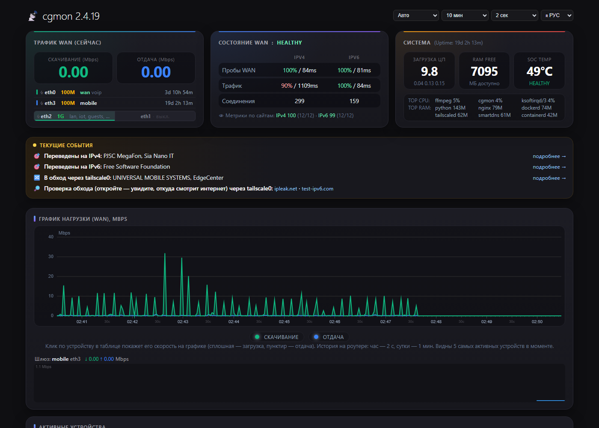
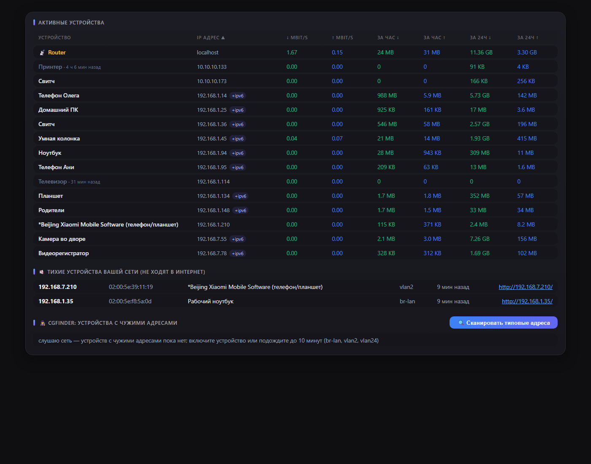
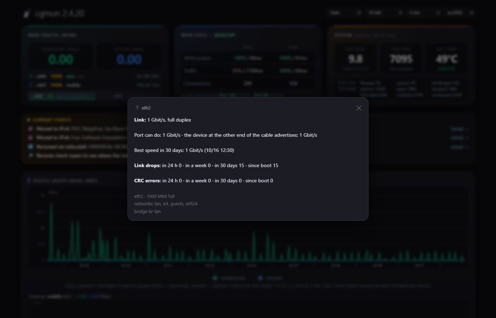
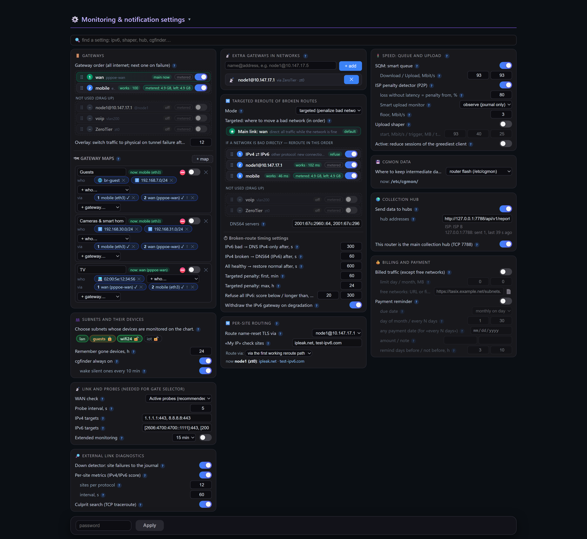
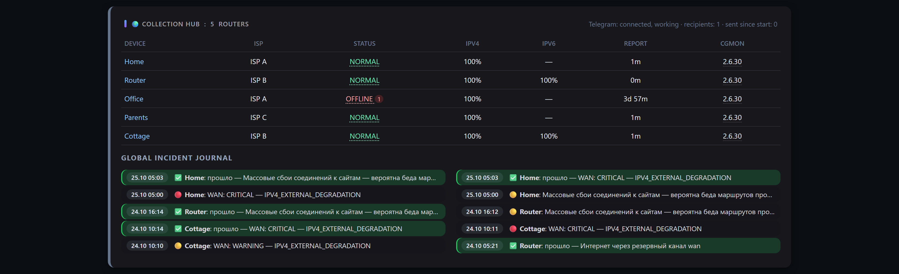
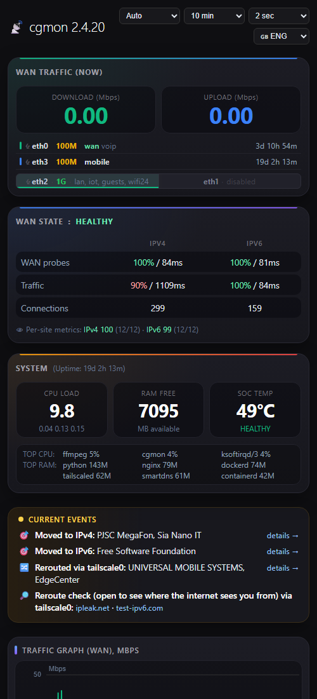

# cgmon

[English](README.md) · [Русский](README.ru.md) · [Oʻzbekcha](README.uz.md) · [Қазақша](README.kk.md) · **中文**

面向 **OpenWrt / ImmortalWrt** 路由器（包括位于运营商级 NAT 之后的路由器）的上行
线路、conntrack/NAT、设备、交换机端口与流量监控工具，并带有汇总多台路由器故障的
中心。一个约 **2 MB** 的静态可执行文件，占用 **3–5 MB 内存**，提供网页和
Telegram 通知。即使在只有 64 MB 内存的旧 MIPS 路由器上也能运行。通俗介绍见
[docs/users.md](docs/users.md)（英文）。



| | | |
|---|---|---|
| [](docs/screenshots/2-devices.png) 设备与 cgfinder | [](docs/screenshots/3-ports.png) 端口详情：链路中断、CRC、速率 | [](docs/screenshots/settings.png) 设置：所有选项以卡片呈现 |
| [](docs/screenshots/hub.png) 汇总中心 | [](docs/screenshots/6-routing.png) 网关与按网络路由 | [](docs/screenshots/8-phone.png) 手机上 |

> 2.x 版本用 Rust 编写，取代 1.x（Go）版本。配置文件、网页、CGI、套接字和向中心
> 上报的格式保持兼容：2.x 中心可以接收 1.x 路由器的报告。

## 理念：指挥，而不是路由

cgmon 建立在 Linux 内核和 OpenWrt 已有的能力之上。**它从不转发流量，也没有任何
数据包经过它**：一切由内核转发，cgmon 负责观察，并在需要时添加、修改或删除自己
的规则：

- **nftables** — 与防火墙并列的自有表（`inet cgmon` — 限制器，
  `inet cgmon_acct` — 流量统计，`inet cgmon_route` — 绕行用的连接标记，
  `inet cgmon_gw` — 网关映射，`inet cgmon_persite` — Per-Site Routing 列表，
  `inet cgmon_v6` — 按协议拒绝）。从不修改防火墙规则，也从不重载防火墙；
- **内核路由** — 基于连接标记的 `ip rule`、自有路由表，以及切换主网关用的
  `ip route replace`；
- **tc** — SQM 队列树和上传整形速率；
- **DNS** — 仅用于 DNS 保护的整协议模式（SmartDNS 或 dnsmasq）以及
  Per-Site Routing 列表中的域名（dnsmasq nftset）。定向模式和绕行不改动 DNS 服务器。

观察同样通过内核完成：经 netlink 读取 conntrack 与 nftables 计数器，从 AF_PACKET
套接字获取 SYN/RST 包和 DNS 应答的副本，用 sysfs 和 ethtool ioctl 读取端口，
外加自有的探测和 TCP 路由追踪。单线程 epoll，没有辅助进程。守护进程停止或崩溃
不会影响连通性：内核继续按最后的规则工作，下次启动时会接管自己的表和状态。

## 功能

**线路与网站**
- **WAN 状态** — 通过 IPv4 和 IPv6 进行 TCP 443 探测，NORMAL / WARNING /
  CRITICAL / RECOVERY 阶段以及易读的事件日志。
- **Down detector** — 在互联网本身正常时，哪些网站对您的客户端停止响应；依据 DNS
  和 AS 数据给出服务和网络所有者名称（Google、Telegram…）。
- **按网站指标** — 针对客户端实际使用的网站给 IPv4 和 IPv6 打分，区分整个协议
  故障与个别网络的问题。
- **查找元凶** — 某协议变差时，路由器对好网站和坏网站做 TCP 路由追踪，指出所有坏
  路径共同经过的节点或互联点。

**端口与网线（物理层）**
- 每个端口的链路中断（包括轮询间隙中的闪断）、速率与双工变化、CRC、帧和 FIFO
  错误；在旧的 swconfig 交换机上按交换机端口统计，并标注 VLAN。
- CRC 错误分级：零星的为警告；占帧数 0.01 %、一天 1000 个或伴随链路中断的为严重
  — 网线即将失效。
- “端口运行速率低于其能力”只在过去 30 天内确实更快过时才报告；显示网线另一端
  设备通告的速率（ethtool）。
- 端口直接显示在 WAN 卡片中：今日链路中断标记，CRC 错误时名称变红（严重时闪烁），
  点击显示详情窗口；同时在“当前事件”中显示一行，并在中心上报告问题。

**设备与流量**
- **设备** — 实时速率、每小时和每天的流量，来自 DHCP、mDNS、NetBIOS 和 UPnP 的
  名称，按 MAC 识别厂商。
- **连接** — 不含 cgmon 自身探测的有效互联网连接数（客户端、路由器服务、
  Tailscale、ZeroTier）；总数显示在提示和事件日志中，因为运营商的 CGNAT 限额会
  全部计入。
- **图表**基于同一个一致的快照：WAN、路由器和各设备的字节计数器同时读取，因此
  设备之和等于 WAN 总量，鼠标悬停在峰值上即可看到是谁造成的。历史保存在路由器上
  （1 小时每 2 秒，1 天每 1 分钟），页面可立即显示 10 分钟 … 24 小时。
- **cgfinder**（类似 MikroTik 的 IP Scan）— 地址不在您网络内的设备（静态 IP 的旧
  摄像头、169.254.x.x）、从不上网的安静设备，以及“开放访问”：路由器在一小时内
  取得设备网络中的地址，让您可以访问它。按需运行 30 分钟。
- **流量统计**使用 nftables 计数器；计费流量为免费网络（TAS-IX 或自定义列表）
  以外的全部流量。
- **租户** — 隔离子网在页面上只能看到自己的设备。

**操作**
- **网关映射** — 哪些局域网客户端走哪个出口：子网、VLAN 或单台设备 → 按顺序排列
  的网关（WAN 线路、Tailscale exit node、经 ZeroTier 的自有路由器），故障时切换
  到下一个。“双运营商”或“电视走另一台路由器”就是这样实现的；已建立的连接不会
  迁移。
- **网关选择器** — 自动发现网关（netifd：默认路由、wan 区域；PPPoE、DHCP、LTE
  调制解调器）；主网关 metric 最小，备用依次排列。默认只观察，只有一个网关时休眠。
- **DNS 保护** — 某网络所有者的某个协议不佳时，立即拒绝经该协议的新连接（客户端
  立即改用另一协议），或经其他线路绕行。屡次发生时惩罚递增，检查一旦正常即提前
  解除；同一所有者的两种协议从不同时封锁。
- **Per-Site Routing** — 始终经所选网关（隧道、VPN 节点、另一台路由器）访问的网站、
  网络和整个 AS：列表在页面的独立窗口中编辑（每行一个或用 `;` 分隔），域名包括
  所有子域名（dnsmasq nftset 在客户端收到应答前就把地址加入集合），网络和来自
  RIPEstat 的 AS 前缀；这些网站的 IPv6 会被拒绝，客户端经网关使用 IPv4。动态部分
  会自动捕获运营商按名称重置 TLS 的网站并转发。网关故障时这些网站改为直连。
- **SQM 和上传整形器**、运营商 P2P 流量惩罚检测器，以及针对最贪婪客户端的新连接
  限制器（默认仅观察）。

**汇总中心**
- 路由器通过加密通道（AES-256-GCM；令牌从不经网络传输）向一个或多个中心上报
  状态。中心能区分“我的运营商坏了”和“上游线路断了”，并通过 Telegram 通知您。
- **路由器健康**：路由器在中心的状态取其 WAN 阶段和自身问题（端口、备用线路、
  过热、大规模故障…）中最差的一项；点击查看详情。路由器名称链接到它的页面，版本
  号打开带“从中心移除”的信息窗口；沉默 30 天的路由器会被自动遗忘。

**页面**
- 单行当前事件、标出峰值元凶的图表、WAN 卡片中的端口、无需重启即可生效的设置
  （有密码保护和防暴力破解）、设置搜索和插件（页面区块加文件中的设置）。
- 语言：英语、俄语、乌兹别克语、哈萨克语和中文 — 页面、设置说明、日志、事件、
  Telegram 消息和命令行。页面语言在页头选择，并会同时切换守护进程的消息语言
  （`cgmon.yaml` 中的 `lang:`，`auto` 跟随 LuCI）。

## 版本：full、lite、nano

一套代码，三种版本。运行时路由器上缺少的东西（未安装的软件包）只是不启动，不影响
其他功能：页面上该设置显示为灰色，并带有“需要 …”和“安装”链接；“当前事件”中会
出现带 **安装** 按钮的 📦 行（在路由器上用 apk/opkg 安装，需要密码，会检查闪存
空间）。以这种方式安装的 ZeroTier 和 SmartDNS 由 cgmon 自动且安全地配置：
ZeroTier 只会被启动（由您自己加入网络；从不加入公共 Earth 网络），SmartDNS 配置
为加密 DNS，只有在 SmartDNS 能应答时才把 dnsmasq 切换过去 — 否则一切恢复原状。
已经配置好的内容不会被改动。

| 功能 | full | lite | nano | 软件包（mips_24kc 上约 KB） |
|---|:-:|:-:|:-:|---|
| WAN 状态、事件、down detector、按网站指标、查找元凶 | ✅ | ✅ | ✅ | — |
| 设备、带历史的图表、统计与计费流量、cgfinder | ✅ | ✅ | ✅ | — |
| 端口与网线（CRC、链路中断、速率）、swconfig | ✅ | ✅ | ✅ | — |
| 可切换的网关选择器、网关映射 | ✅ | ✅ | ✅ | —（busybox 的 `ip` 即可） |
| DNS 保护整协议模式（不返回 AAAA、DNS64、撤销 IPv6 网关） | ✅ | ✅ | ✅ | —（dnsmasq、odhcpd） |
| Per-Site Routing 列表（域名、网络、AS） | ✅ | ✅ | ✅ | —（带 nftset 的 dnsmasq-full） |
| 汇总中心、上报、Telegram、LuCI 页面 | ✅ | ✅ | ✅ | —（uclient-fetch + libustream） |
| 使用 cake 的 SQM、上传整形器 | ✅ | ✅ | ✅ | `tc-tiny`、`kmod-sched-cake`、`kmod-sched-core`、`kmod-ifb`（≈240） |
| 硬连接限制 | ✅ | ✅ | — | `kmod-nft-connlimit`（≈10） |
| 自有路由器作为映射网关（ZeroTier） | ✅ | ✅ | — | `zerotier`（含 libstdc++ ≈1150） |
| 用于 HTTPS 的 curl | ✅ | ✅ | — | `curl`（≈350） |
| 定向 DNS 保护、绕行、按网络拒绝 IPv6 | ✅ | — | — | `smartdns`（≈200）、`ip-full`（≈400）、`curl` |
| 下载大小，MB | 2.0–3.1（未压缩） | 0.85–0.99（UPX） | 0.85–0.99（UPX） | |

解压后三种版本只差几千字节；区别在于它们在路由器上需要哪些软件包、以及会提示安装
什么。lite 和 nano 用 UPX 压缩以节省闪存。

- **full** — 全部功能；适合 x86 和性能强的 ARM 路由器。
- **lite** — 除 SmartDNS 及其相关功能（定向模式、绕行）外的全部功能。中等大小的
  软件包 — curl、ZeroTier、tc — 一键安装。
- **nano** — 适合闪存很小的弱路由器（例如 ImmortalWrt 25.12 上的 TP-Link
  TL-WR1043N/ND v4）：一切都在原厂镜像上运行（nftables、dnsmasq-full、busybox、
  swconfig、uclient-fetch）。唯一可选的附加是带 cake 的 SQM（≈240 KB）— 运营商
  提供的路由器常常是强 CPU 配小闪存。

`cgmon --version` 显示版本类型（“2.7.0 lite”）；页面在版本号旁显示它。

## 资源

| 路由器 | cgmon CPU | 内存 |
|---|---|---|
| x86 Celeron J1900，40+ 台设备，中心，DNS 保护，QoS，页面打开 | 约单核的 2.9 % | 约 5 MB |
| x86 Celeron J1900，带端口和交换机的网关，端口监视常开 | 约单核的 0.7 % | 约 2.6 MB |
| TP-Link TL-WR1043ND v3（MIPS 74Kc 720 MHz，64 MB），交换机 | 约单核的 0.8 % | 约 3 MB |

闪存中只存放可执行文件：页面和 CGI 脚本以压缩形式嵌入其中，启动时解压到
`/tmp/cgmon/www`（`/www` 中放置符号链接）。内含页面的 MIPS 可执行文件为 3.0 MB，
UPX 压缩后为 0.93 MB。所有临时文件都在 `/tmp/cgmon`。累积数据（统计、指标…）的
存放位置可设置：路由器闪存（`/etc/cgmon`）、内存（`/tmp`）或 U 盘/硬盘。

关闭的功能不占内存、不耗 CPU；在弱路由器上，开销较大的页面区块（端口、TOP
CPU/RAM）需按按钮开启。

## 要求

带 nftables 的 OpenWrt / ImmortalWrt（`nft`；在旧的 firewall3 系统上安装
`nftables` 软件包即可 — 不改动防火墙）。架构：x86_64、aarch64、MIPS 24Kc 以及
Rust 支持的其他架构。

各功能所需软件包见上方版本表；经 ZeroTier 作为映射网关的路由器需要把 ZeroTier
流量转发到其 WAN。页面（“安装”按钮）或 `cgmon deps` 会显示缺少什么；
`cgmon deps --install` 可在命令行安装。

## 安装

### 下载哪个文件

每个[发布版本](https://github.com/real4root/cgmon/releases)都为七种架构提供三种
版本 — 包括裸可执行文件和软件包。lite 和 nano 用 UPX 压缩（≈1 MB）：路由器的
内存通常远大于闪存，可执行文件启动时会把自己解压到内存中。

| 您的路由器（`/etc/openwrt_release` 中的 `DISTRIB_ARCH`） | 典型平台 | 文件后缀 |
|---|---|---|
| `x86_64` | x86/64 | `x86_64` |
| `i386_pentium4` | x86/generic | `i686` |
| `aarch64_*` | mediatek/filogic、qualcommax、rockchip、bcm27xx | `aarch64` |
| `arm_cortex-a7/a9/a15…` | ipq40xx、ipq806x、mvebu、sunxi | `armv7` |
| `arm_arm926ej-s`、`arm_xscale`、`arm_mpcore` | kirkwood、oxnas | `armv5te` |
| `mips_24kc` | ath79（TP-Link TL-WR1043ND 等） | `mips` |
| `mipsel_24kc` | ramips mt7621、mt76x8 | `mipsel` |

### 从软件包安装

OpenWrt / ImmortalWrt 25.x（apk）：

```sh
apk add --allow-untrusted /tmp/cgmon-lite-<version>-r1-<arch>.apk
```

OpenWrt 24.10 及更早版本（opkg）：

```sh
opkg install /tmp/cgmon-lite_<version>-1_<arch>.ipk
```

软件包会安装 `/opt/cgmon/cgmon` 和 `/etc/init.d/cgmon` 服务，若没有配置则创建一个
最小配置（全部默认 — 仅观察），并启动服务。CPU 不匹配的软件包会拒绝安装。软件包
未签名，因此需要 `--allow-untrusted`；校验和见 `SHA256SUMS`。不同版本的软件包
（`cgmon`、`cgmon-lite`、`cgmon-nano`）只有在卸载旧的之后才能互相替换。

### 从可执行文件安装

```sh
scp cgmon root@router:/tmp/cgmon       # 对应您架构的可执行文件（uname -m）
ssh root@router /tmp/cgmon --install   # 向导：最简、常规或详细配置
```

`--install-min` 只询问页面密码，`--install-basic` 还包括汇总中心、Telegram、流量
统计和网关，`--advanced-install` 会逐项设置全部参数。能在页面上修改的内容不会被
询问。向导会写入 `/etc/cgmon/cgmon.yaml`（已有文件原地修改并保留注释），安装并
启动服务。

页面会自动安装：它嵌入在可执行文件中（`web.embedded`），地址为
`http://<路由器>/status.html`。要移除 cgmon，运行 `cgmon --uninstall`（移除服务和
页面链接；`/etc/cgmon` 中的配置和数据保留）。

页面密码、汇总中心和 Telegram 在 LuCI 的 **Services → cgmon** 中设置（存在 LuCI
时 cgmon 会自动安装该页面）。没有密码时监控页面为只读。

检查：`cgmon status`、`cgmon top`、`cgmon ports`、`cgmon sites`、
`logread | grep cgmon`。

## 默认安全

默认配置不封锁、不整形、不向任何地方发送任何内容 — 只观察。只有输入密码才能在
页面上修改设置（连续五次错误会触发暂停）；**未设置密码时页面为只读**，无法修改
任何内容。密码和中心可在 LuCI（“Services → cgmon”）、向导或 `cgmon.yaml`
（权限 0600）中设置；密钥从不发送到页面。所有来自外部的数据（设备名称、DNS、
报告）都有大小限制并经过转义，外部数据的解析器有模糊测试风格的测试覆盖。

## 文档

- [docs/users.md](docs/users.md) — 用通俗语言介绍 cgmon 能做什么（英文）。
- `cgmon --help`、`cgmon --help-advanced` — 命令、文件、端口、示例（设置
  `lang: zh` 或 `CGMON_LANG=zh` 即为中文）。
- [config.reference.yaml](config.reference.yaml) — 所有参数及说明（注释为俄文；
  页面和向导会用您的语言显示）。
- [docs/hub.md](docs/hub.md) — 汇总中心、TCP 7788 端口、安全、Telegram（英文）。
- [CHANGELOG.md](CHANGELOG.md) — 版本历史（英文）。

## 构建

需要 Rust（rustup）；musl 链接器为 `rust-lld`（x86_64、aarch64）或 zig（MIPS）。

```sh
cargo test  --release --target x86_64-unknown-linux-musl
cargo build --release --target x86_64-unknown-linux-musl
cargo build --release --target aarch64-unknown-linux-musl
# MIPS 24Kc（ath79/ramips，OpenWrt mips_24kc）：std 从源码构建
cargo +nightly build --release -Z build-std=std,panic_abort --target mips-unknown-linux-musl
```

默认构建 full；lite 和 nano 使用 `--no-default-features --features lite`（或
`nano`）。`tools/mkrelease2.sh` 为所有架构构建全部三种版本。翻译位于
`i18n/*.tsv`；`python3 tools/i18n.py check` 会显示缺少什么。

依赖：`libc`、`aes-gcm`、`sha2`。没有 tokio、serde 或 regex：单线程 epoll、手写
JSON、经 netlink 读取 nftables 计数器。按组件的 CPU 和内存剖析可用
`cargo build --features prof` 和 `cgmon prof` 获得。

## 构建 OpenWrt 软件包

OpenWrt 软件包（`cgmon`、`cgmon-lite`、`cgmon-nano` 变体）位于
[openwrt/package/cgmon](openwrt/package/cgmon)，遵循 `packages` feed 的结构（使用
`lang/rust/rust-package.mk`）。在带有 `packages` feed 的 OpenWrt buildroot 或 SDK
中：

```sh
cp -r openwrt/package/cgmon feeds/packages/net/cgmon
./scripts/feeds update -i packages && ./scripts/feeds install cgmon
make menuconfig                  # Network → Network monitoring → cgmon / cgmon-lite / cgmon-nano
make package/cgmon/compile V=s
```

软件包会安装 `/usr/sbin/cgmon`、procd 服务和最小的 `/etc/cgmon/cgmon.yaml`
（conffile，升级时保留）。

## 许可证

GNU 通用公共许可证 v3.0 或更高版本 — 见 [LICENSE](LICENSE)。您可以自由使用、研究、
修改和分发；修改后的版本必须以相同许可证连同源代码一起发布。
